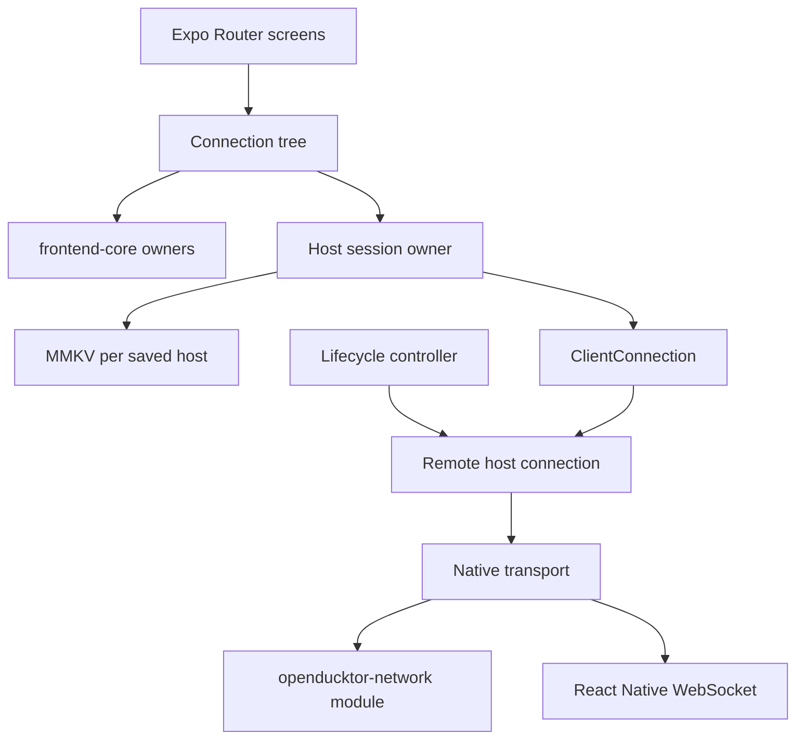

# OpenDucktor mobile

The OpenDucktor app for iOS and Android. It is a remote client of one OpenDucktor host at a time: the desktop app or the web runner with Remote control turned on. The host keeps agent execution, Git, files, terminals, and task data. The app monitors agents, answers pending questions and permission requests, manages tasks and their workflow, reviews work, sends instructions, and opens terminals.

[ADR 0012](../../docs/adr/0012-build-the-mobile-client-as-an-expo-shell-over-frontend-core.md) records the main decisions. [The remote host protocol](../../docs/remote-host-protocol.md) defines the host side.

## Architecture

The app is an Expo SDK 58 shell over `@openducktor/frontend-core`. It reuses the frontend-core queries, session projection, history, recovery, task operations, and drafts. It adds platform adapters, local workspace selection, and a native UI.

This diagram shows the main modules and how they connect.



| Area | Path | Owns |
|---|---|---|
| Entry | `index.ts`, `src/platform/install-globals.ts` | Platform globals, themes, Expo Router entry |
| Host session | `src/host-session/` | Saved hosts, the active connection, add, switch, remove, lifecycle, connection phases, command gate, command outcomes |
| Device data | `src/device-data/` | Device records and per-host storage on MMKV |
| Platform adapters | `src/platform/` | Remote transport, attachment staging, device files, resource files |
| Composition | `src/composition/` | frontend-core providers and local workspace selection |
| Features | `src/features/` | The Sessions list, chats, tasks, workflow, the session screen, composer, the model picker, review, files, terminals, settings, diagnostics |
| Rich content | `src/rich-content/` | Markdown, code, diffs, images, isolated WebView pages |
| UI kit and theme | `src/ui/`, `src/theme/` | Components, semantic colors, the type ramp, motion tokens, light and dark themes |
| Native modules | `modules/` | `openducktor-network` (HTTP), `openducktor-keyboard` (hardware Enter) |
| Config plugins | `plugins/` | Android network security, Android release signing, iOS release signing |

### Design system

- The app uses the desktop brand on both platforms: slate surfaces, outlined white cards, the OpenDucktor violet for the main action, and the desktop status colors. Navigation and sheets stay native. The tabs are JavaScript tabs with the app tab bar of `src/navigation/tab-bar`.
- Text uses Space Grotesk through the `Text` variants of `src/ui/text.tsx`. IDs, paths, and code use IBM Plex Mono.
- Screens use only theme colors. `theme.desktop` holds every desktop CSS color by its camel case name, so `text-warning-muted` is `theme.desktop.warningMuted`. `theme.palette` holds the Tailwind palette, `theme.tones` the status families, and `theme.lanes` the board lane colors.
- When three or more call sites use the same color and alpha, add a color with a role name to `theme.colors` in `buildTheme` of `src/theme/tokens.ts`, such as `insetFill` for `bg-muted/30`. Otherwise, add the alpha at the call site with `withAlpha` from `src/theme/color-alpha.ts`. Do not add hex alpha digits in a template literal such as `` `${color}40` ``: a color that already has an alpha becomes a 10-digit color, and React Native drops it with only a log line. The `anti-slop/no-hex-alpha-suffix` lint rule rejects this.
- A `StyleSheet.create` function returns its styles object directly, and each style reads its `theme` and `rt` values itself. The Unistyles Babel plugin finds style dependencies only there, so a style that reads a local copy or a helper does not update when the theme or the font scale changes. The `unistyles/no-stylesheet-dependency-aliases` lint rule enforces this.
- Unistyles updates styles on its own only on React Native and Reanimated views. A component of another package, such as `FlashList`, gets copies of its styles, so a theme color on it keeps the old theme. Put that color on a wrapping React Native view. When the ref of the component is its native view, as for the Gesture Handler button, wrap it with `createUnistylesElement`, as `Touchable` does. The `unistyles/no-themed-colors-on-unbound-components` lint rule enforces this.
- A value outside styles, such as the color of a spinner or an SVG, comes from `useAppTheme` of `src/theme/app-theme-context.tsx`. Only `AppThemeProvider` calls `useUnistyles`, because each call adds a native listener and builds new proxies on each render. The `no-restricted-imports` lint rule rejects `useUnistyles` and `withUnistyles` in other files.
- A list view with many color variants, such as a badge tone or a task chip paint, takes plain styles from `themeStyleCache` of `src/theme/theme-style-cache.ts` and the theme of `useAppTheme`. A stylesheet function runs native code on each call, so a list row calls none.
- Each screen copies its desktop component. The first tab, Sessions, is the session list of the desktop sidebar.
- `scripts/desktop-theme-tokens.ts` generates `src/theme/desktop-colors.ts` from the desktop `styles.css`. A test fails when the two differ.
- Icons use the Lucide font, as the desktop does. `src/ui/icon-names.ts` maps each app icon to a Lucide name. `src/ui/brand-icons.tsx` draws the desktop role icons and the runtime brand marks.
- `Touchable` gives each control its press feedback on the UI thread: rows highlight, cards and buttons scale, and text controls dim.
- `ActionMenu` is the one dropdown menu. Overflow controls show a plain horizontal ellipsis. A menu choice runs after the menu has closed, because iOS cannot show a dialog or a picker over an open menu.
- A control that opens a picker, a menu, or a sheet from a form or the composer calls `blurFocusedField` of `src/ui/keyboard-dismiss.ts` first. On Android, a field that keeps the focus takes it back when the new window closes, and the keyboard then opens over the screen. `SelectTrigger` does this for every form picker and menu.
- Toasts show near the top of the screen, below the tallest top bar of a screen or a sheet, so they never cover Back, Close, or a header menu. On Android, a React Native `Modal` is its own window and covers the root view, so each `Modal` renders `ModalFeedbackHost` last in its gesture root. The newest open modal then shows the toasts.
- Route sheets use `SheetScreen`, because Android form sheets have no navigation bar.
- A window lower than 500 points, such as a phone in landscape, keeps its height for content. `useCompactHeight` of `src/ui/use-wide-layout.ts` reports it. In this layout:
  - The tabs move to a navigation rail on the left edge. The create button sits in the middle of the rail's right edge, and its fan opens to the right.
  - The board shows one lane, with its cards in two columns.
  - Task details show the summary in a pane beside the sections.
  - A session shows its workflow rail and todos in a right panel.
  - Form footers put their actions in one row.
  - A menu taller than the window puts its items in up to three columns, so all items show without a scroll.
- `useWideLayout` is true only on a window with room in both directions, such as a tablet. A phone in landscape uses the low window layouts above, not the two-pane tablet layouts.
- Every copy action uses `useClipboardCopy` of `src/platform/use-clipboard-copy.ts`. Android 13 and later shows its own preview of the copied content, so a copy there shows no success toast. A failed copy always shows its reason.
- The app draws edge to edge. A scroll view that ends at the bottom edge of a pushed screen pads its end with `useScreenEndSpace` of `src/ui/screen.tsx`, so its last rows scroll clear of the Android navigation buttons. A tab screen uses `useTabBarSpace`.
- `src/ui/haptics.ts` gives one haptic for each user action. A haptic never carries meaning alone.

### Host connections

- The app saves a host only after discovery, negotiation, and the first synchronization succeed.
- One `ClientConnection` exists for the active saved host. A host switch saves drafts, unmounts the connection tree, disposes the connection, and creates a new one.
- Each saved host has its own MMKV instance for drafts, the selected workspace, and UI state. Removing a host deletes that instance.
- A saved host keeps the `hostId` of the discovery reply. A host from before host IDs gets it at its next connection.
- When an added address answers with the `hostId` of a saved host, the app moves that saved host to the new address. It keeps its name and its MMKV instance, and the app adds no second entry.
- The app reads each entry of the saved host record on its own. A damaged entry stays unchanged in the record until the user removes it. The host lists show it with its reason and a Remove action. Removing it deletes the MMKV instance of its ID. An active host ID of a damaged entry means no active host.
- Only a saved host record that is not JSON or has no host list shows the reset screen. The reset deletes the record and the MMKV instance of each host ID that the record still names.
- The lifecycle controller keeps the connection active in the foreground with a network link.
- When the app goes to the background or becomes inactive, it saves drafts at once. iOS reports only `inactive` while the app switcher shows, and a swipe there ends the app. Git refreshes and session read marks react only to the background, because iOS also reports `inactive` while Control Center or a system sheet shows.
- The connection closes after 60 seconds in the background, because Android reports the photo picker, the share sheet, and permission dialogs as background.
- A changed network link starts a new attempt at once. On return, a connection that stayed open starts a new attempt when the link dropped or changed type in the background, or the app was away longer than 60 seconds, as after an iOS suspension. The new attempt runs the recovery barrier before commands open again.
- A connection that is not connected on return also starts a new attempt at once. Android blocks the network of an app in the background, so a failure from that time says nothing about the host. Until the new attempt connects or fails, the connection phase shows Reconnecting and not that failure.
- After 5 seconds or more in the background, such as a locked screen, the host stream must prove that it lives. Android freezes a background app after about 10 seconds, and a VPN or a Wi-Fi power save can drop an idle flow without a close. A heartbeat host proves its stream with the heartbeats that arrived during the pause, or with its next heartbeat. A stream that stays silent, or a host without heartbeats, starts a new attempt as for a lost connection.
- For 5 seconds after a return, a failed attempt still shows as Reconnecting while the next attempts run, because a VPN or a Wi-Fi radio can need a few seconds after unlock. A permanent failure shows at once.
- The connection banner shows Reconnecting and Restoring only after 800 ms, so a quick reconnect after unlock shows nothing. A failure shows at once.
- A host read, such as the session history, waits for the reconnect and runs again. A session history that failed while the host was away loads again when the connection returns.
- One expo-network listener stays for the app process. The iOS module cannot restart its path monitor after its last listener goes.
- Every control that sends a host command reads one command gate. The gate is open only while the connection state is `connected`. Draft editing stays available.
- The app never resends a mutation, reply, message, or terminal input after an unknown outcome. It reads the current host state after the reconnect.

### Transport rules

`src/platform/native-remote-transport.ts` connects the [network module](modules/openducktor-network/README.md) to `RemoteTransport`. The module README lists the native rules. The adapter adds two rules:

- A 3xx response is an invalid endpoint.
- A certificate failure is permanent. The app never downgrades HTTPS to HTTP.

### Session startup

- Task and workspace startup use the connection's in-memory attempt owner. A newly created worktree shows setup steps. Starts in the current checkout or an existing worktree keep the disabled form and a loading submit button. Failures keep their cause and recovery actions. The app saves no startup history.
- A foreground start keeps its guarded full sheet until preparation ends. Task starts can move the same trace to the startup overlay with Continue in background. Background task submission closes its sheet at once and never changes the current screen on completion. Workspace starts stay in their sheets.
- The startup overlay sits above the bottom tab bar and keeps every active start available. Step lists start collapsed and keep the user's expansion choice through updates. Open and recovery actions stay outside the scrolling details. On a short screen, the stack scrolls to keep every card and action reachable. Success expires after 10 elapsed seconds, including hidden time. Failed and canceled starts stay until dismissal or explicit recovery.
- Hiding the app keeps the existing connection lifecycle and the user's startup choice. Foreground handoff waits until the app is visible. A lost result stays unconfirmed and never sends a replacement launch.
- Action details show a separate read-only terminal page. It sends no input or resize. Read output as text takes a static accessible snapshot without announcing each output chunk. The action terminal keeps its initial command result after startup feedback expires.

### Runtime globals

`src/platform/install-globals.ts` runs before all other app code. It supplies a streaming UTF-8 `TextDecoder`, a grapheme `Intl.Segmenter`, `Array.prototype.toSorted`, and `crypto` when Hermes or React Native does not have them. Then it checks every global and built-in that shared code needs, and startup stops with the name of each missing one.

### Task artifacts

- The Artifacts work view follows [task artifacts](../../docs/task-artifacts.md#mobile-app).
- A free artifact goes chunk by chunk into a device file, so its bytes never enter JavaScript memory. Only a text format reads the bytes back to show the text.
- The device file goes away when its last view closes, or when a new read of a changed artifact replaces it.

## Setup

1. Install the repository dependencies from the repository root: `bun install`.
2. For iOS, install Xcode 26 and CocoaPods.
3. For Android, follow [Android setup](#android-setup).

The `ios` and `android` commands build the isolated pages first, so a new clone needs no other step.

The app needs a host with Remote control turned on. Open Settings, Remote control on the host, enable it, and copy the address or show its QR code.

### Android setup

Do these steps once on each development machine.

1. Install Android Studio, for example with `brew install --cask android-studio`. Open it once. Its setup wizard installs the Android SDK, the emulator, and the platform tools in `~/Library/Android/sdk`.
2. Add these lines to your shell profile, such as `~/.zshrc`, and open a new terminal. Gradle needs JDK 21 or later and `ANDROID_HOME`. The first line uses the JDK that Android Studio includes.

   ```sh
   export JAVA_HOME="/Applications/Android Studio.app/Contents/jbr/Contents/Home"
   export ANDROID_HOME="$HOME/Library/Android/sdk"
   export PATH="$JAVA_HOME/bin:$PATH:$ANDROID_HOME/emulator:$ANDROID_HOME/platform-tools"
   ```

3. In a new terminal, make sure that `java -version` shows version 21 or later.

4. In Android Studio, open Device Manager and create a virtual device with a recent Pixel profile and an API 36 system image. Use an ARM64 image on Apple silicon.

### Run on Android

Run these commands from the repository root. They also work in `apps/mobile`.

| Goal | Command |
|---|---|
| Develop with hot reload | `bun run android`. Expo uses the first running device or virtual device, and starts a virtual device when none runs. It builds the debug app, installs it, and starts Metro. A saved TypeScript change shows at once. Add `--device` to choose the device from a list. |
| Use a physical phone | Turn on Developer options and USB debugging on the phone, connect it by USB, then run `bun run android --device` and select it. |
| Install the app on a phone | Connect the phone by USB, then run `bun run android:release`. It builds the release app, installs it, and opens it. It starts no Metro, so the app runs without this computer. Add `--device` to choose from more than one device. |
| Check speed and memory | `bun run android:release`. A debug build is much slower than a release build. |

A change in `modules/`, `plugins/`, or `app.config.ts` needs a new `bun run android`, because it changes native code. Press `Cmd+M` in the emulator, or shake a phone, to open the developer menu.

To connect, enter the address that Remote control shows on the host. The emulator uses the network of its computer, so a Wi-Fi or Tailscale address of the host works. Do not use `localhost`, which names the emulator itself.

## Commands

Run these commands in `apps/mobile`. `bun run ios`, `bun run android`, and `bun run android:release` also work from the repository root.

| Command | Purpose |
|---|---|
| `bun run start` | Starts Metro for a development build |
| `bun run ios` | Generates the iOS project and runs the app on a simulator or device |
| `bun run android` | Generates the Android project and runs the app on an emulator or device |
| `bun run android:release` | Builds the release app and installs it on an emulator or device, without Metro |
| `bun run native` | Generates `ios/` and `android/` from the app config. The name is not `prebuild`, because `bun run build` would run a `prebuild` script first. |
| `bun run build` | Builds the isolated pages and exports the iOS and Android JavaScript bundles |
| `bun run typecheck` | Checks the app and test TypeScript projects |
| `bun run lint` | Runs oxlint with the repository rules |
| `bun run test` | Runs the unit and integration tests |
| `bun run scripts/desktop-theme-tokens.ts` | Regenerates `src/theme/desktop-colors.ts` after a desktop theme change |
| `bun run scripts/lucide-glyphs.ts` | Regenerates `src/ui/lucide-glyphs.ts` after a change to `src/ui/icon-names.ts` |
| `./scripts/generate-app-icons.sh` | Regenerates the app icons from `assets/source` |

`ios/` and `android/` are generated and ignored by Git. Change native settings only in `app.config.ts` and `plugins/`.

## Native dependencies

| Area | Library |
|---|---|
| Navigation | `expo-router` (native stack, JavaScript tabs with the app tab bar in `src/navigation/tab-bar`), `react-native-screens`. The swipe back of `src/navigation/swipe-back-detector.tsx` reads a source module and the Fabric fields of `react-native-screens`, so `package.json` pins its exact version. Test the swipe back before you change it. |
| Styles | `react-native-unistyles` v3 with `react-native-nitro-modules`. `AppSystemBars` in `src/ui/app-system-bars.tsx` sets the system bar icons: the React Native `StatusBar` for the status bar, because it also reaches open modals, and `react-native-edge-to-edge` for the Android navigation buttons. |
| Lists | `@shopify/flash-list` v2, with `patches/@shopify%2Fflash-list@2.3.3.patch`. The patch applies the guard of the open upstream pull request [Shopify/flash-list#2293](https://github.com/Shopify/flash-list/pull/2293): a cell layout event that arrives after the list data shrank no longer stops the app. Remove the patch when a release has the guard. |
| Motion and gestures | `react-native-reanimated` 4, `react-native-worklets`, `react-native-gesture-handler` |
| Keyboard | `react-native-keyboard-controller`, `modules/openducktor-keyboard` |
| Storage | `react-native-mmkv` v4. The app stores no credential. Use Expo SecureStore for a later sensitive value. |
| Network | `modules/openducktor-network`, `expo-network` for link state |
| Files and images | `expo-file-system`, `expo-document-picker`, `expo-image-picker`, `expo-image-manipulator`, `expo-image` |
| Camera | `expo-camera` for the host QR code only |
| Menus | `ActionMenu` in `src/ui/action-menu.tsx` |
| Isolated pages | `react-native-webview` |
| Icons | The Lucide font from `lucide-static`, `react-native-svg` for role icons and runtime marks |
| Fonts | `@expo-google-fonts/space-grotesk`, `@expo-google-fonts/ibm-plex-mono` |
| Haptics | `expo-haptics` |
| Other | `expo-clipboard`, `expo-sharing`, `expo-crypto`, `expo-splash-screen`, `expo-font` |

### Build settings

- `metro.config.js` turns on `inlineRequires`, so a module runs when the app first uses one of its imports. The first frame then runs only the modules that it needs. Imports only for their effects keep their place and order.
- `metro.config.js` resolves three imports to empty modules, because the app never runs them on the device: `katex` from `micromark-extension-math`, `expo-symbols` from Expo Router, and the locale index of Zod. The isolated pages, which render math, build with Bun.
- `package.json` sets the Reanimated static flags `ANDROID_SYNCHRONOUSLY_UPDATE_UI_PROPS` and `IOS_SYNCHRONOUSLY_UPDATE_UI_PROPS`. An animation of a transform, an opacity, or a color then updates the native view directly, without a React Native commit on each frame. A change of these flags needs a native build.

## Testing

Read [Mobile tests](../../docs/testing.md#mobile-tests) for the test rules and the CI builds. The app also has these checks:

- `src/theme/desktop-colors.test.ts` fails when a desktop theme color changes without a mobile token update.
- `src/rich-content/isolated-page/build-isolated-page.test.ts` fails when a page calls a built-in that came after Safari 16.4 and that `page-src/shared/page-globals.ts` does not supply. Pages run in the system WebView, and iOS 16.4 is the oldest supported version.
- Fix each React Doctor finding. When a rule does not apply to a line, put a `react-doctor-disable-next-line` comment with a reason above that line.
- `doctor.config.jsonc` holds the React Doctor settings of the app, with a reason for each rule change. A scan of `apps/mobile` reads it instead of the root `doctor.config.json`.

## Device validation

Automated tests cannot measure frame timing, input latency, memory, or accessibility on a device. Before a release, run these checks on a release build on one mid-range Android phone and one iPhone on the oldest supported iOS version, against a real host on a protected network.

| Workload | Check |
|---|---|
| 10 workspaces, 25 concurrent sessions, 30 minutes of agent activity | Sessions, Tasks, and an open session stay responsive. Memory does not grow without end. |
| A session with 10,000 transcript entries | Scrolling, Jump to latest, and message navigation stay smooth. |
| An answer of 200,000 characters | The session opens without a pause, and the answer scrolls smoothly. |
| A board with 2,000 tasks | Column paging and scrolling stay smooth. |
| A 5,000-line diff in Changes and in a Tool Call | Changes scrolls smoothly. In the transcript, Show all opens the full diff in its own list. |
| Background for 5 seconds, then for 2 minutes; network off and on; host restart; host switch | The app reconnects, restores work, and repeats no command. |
| VoiceOver and TalkBack, large text, rotation, light and dark themes | Every control has a label and a usable size. |

Measure frames with the Android GPU rendering profile (`adb shell dumpsys gfxinfo com.openducktor.mobile`) and the Xcode Instruments Animation Hitches template. Measure memory with Android Studio Memory Profiler and the Instruments Allocations template. Record the device, OS version, build number, and the results in the release pull request.

## Release

[The release process](../../docs/release-process.md#build-the-mobile-app) builds the store binaries and lists the secrets.

- Before the first release, the project owner creates the App Store Connect and Google Play app records for `com.openducktor.mobile`. Google Play requires a first Android build that the owner uploads by hand.
- `plugins/with-ios-release-signing.js` sets manual signing on the app target only. Signing settings on the `xcodebuild` command line also reach the Pods targets.
- A local Android release build without `OPENDUCKTOR_ANDROID_UPLOAD_KEYSTORE_PATH` signs with the debug key. Use it only for profiling.

## Permissions

| Platform | Permission | Reason |
|---|---|---|
| iOS | Camera | Scan the host QR code |
| iOS | Local Network | Connect to hosts on the local network |
| iOS | App Transport Security exception | Plain HTTP to hosts on a protected network |
| iOS | Photo library add | Save Image in the share sheet |
| Android | `INTERNET`, `CAMERA` | Host connections and the QR scan |
| Android | Cleartext traffic, system trust anchors only | Plain HTTP to hosts on a protected network |

The app asks for camera access only when the user starts a QR scan. The photo library picker needs no library permission.

The iOS app also has photo library read and microphone reasons, but it never asks for these permissions. App Store Connect can reject a build without them, because the linked camera and image picker code calls their permission APIs.
