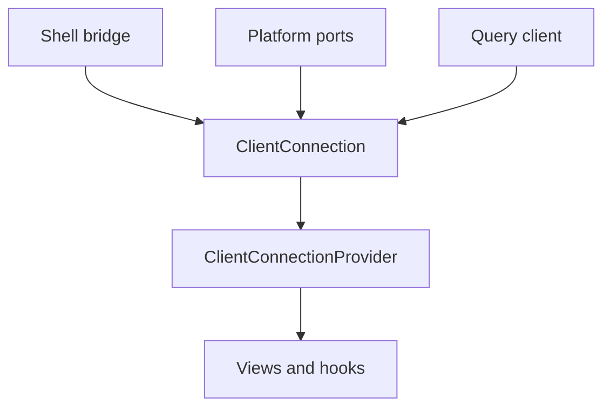
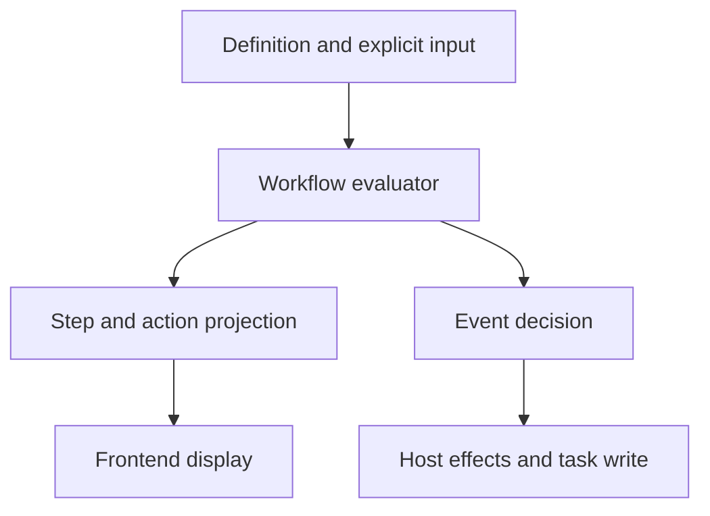

# Architecture and data flow

Use this document to find the owner of a rule and trace a user action across packages.

OpenDucktor supports OpenCode, Codex, and Claude runtimes. OpenCode is the default. `packages/frontend-core` holds the client behavior that all clients share. `packages/frontend` is the shared browser UI. Electron and `packages/openducktor-web` provide the shells. `packages/host` serves both shells. The desktop app runs on macOS, Windows, and Linux. `apps/mobile` is the native iOS and Android client of a remote host.

This guide covers the desktop app, the browser runner, and the mobile app. Read [the marketing website guide](../apps/marketing-website/README.md) for the public Astro website.

## Layer ownership

| Layer | Main code | Owns | Does not own |
|---|---|---|---|
| UI | `packages/frontend/src/pages`, `packages/frontend/src/components` | Rendered state and local interaction | Workflow rules and status transitions |
| Frontend state | `packages/frontend/src/state/app-state-provider.tsx`, `packages/frontend/src/state/operations/*` | UI state, task and workspace operations, provider composition | Schemas, task mutations, source live runtime state |
| Frontend core | `packages/frontend-core/src/*` | Host connection lifetime, query caches, live session projection, history merge, notification policy, connection recovery, drafts | Presentation, device APIs, workflow policy, source live runtime state |
| Contracts | `packages/contracts/src/*` | Zod schemas for tasks, sessions, workflows, host commands, and MCP data | Runtime control and workflow policy |
| Core | `packages/core/src/ports/agent-engine.ts`, `packages/core/src/services/*` | Shared ports, ODT tool name helpers, and services | Workflow definitions, role policy, and task-store adapters |
| Workflows | `packages/workflows/src/*` | Pure workflow evaluation, the built-in definition, role policy, prompts, and presentation rules | I/O, storage, React, runtime descriptors, and native runtime calls |
| Clients and runtime adapters | `packages/host-client/src/*`, `packages/adapters-opencode-sdk/src/*`, `packages/adapters-codex-app-server/src/*` | Host client and native runtime protocols | Workflow policy and shell transport |
| Host | `packages/host/src/*` | Command router, Effect services, live session state, runtime drivers, process, files, Git, task store, and MCP | Frontend cache and public schemas |
| Runtime orchestration | `packages/runtime-orchestration/src/*` | Shared runtime lifecycle, registry, admission, and lifecycle plans | Platform processes, task policy, and settings persistence |
| Remote host | `packages/remote-host/src/*` | Remote access, connection lifetime, and shared HTTP, SSE, and WebSocket transport | Workflow policy and runtime lifecycle |
| Shells | `apps/electron/src/*`, `packages/openducktor-web/src/*` | IPC, preload, HTTP/SSE, renderer start, URLs, and previews | Workflow policy and task-store rules |
| Mobile client | `apps/mobile/src/*`, `apps/mobile/modules/*` | Native UI, saved hosts, native transport, device storage, app lifecycle | Host work, workflow policy, and shared client behavior |
| MCP | `packages/openducktor-mcp/src/*` | stdio, schema checks, bridge readiness, and `odt_*` calls | UI state and direct SQLite access |

The host supplies one `RuntimeDriver` per runtime kind to the shared orchestrator. [ADR 0010](adr/0010-own-runtime-orchestration-in-a-platform-independent-package.md) defines this boundary. Both shells use the remote host package. Read [the remote host protocol](remote-host-protocol.md) before you change that transport.

## Shell startup

`packages/frontend` exports `bootstrapOpenDucktorShell(...)` and the `ShellBridge` contract. The bootstrap creates one `ClientConnection` for the selected host, reads settings for the theme, selects browser or hash routing, and renders the app under `ClientConnectionProvider`. A host change from a local host first saves drafts and stays on the page when a save fails. A remote host keeps its drafts in page memory, so its host change does not wait for them. Then the host change unmounts the app, disposes the connection, and reloads the document. See [the frontend core](#frontend-core).

`apps/electron` supplies IPC, preload events, context isolation, renderer sandboxing, and host cleanup. `packages/openducktor-web` starts a loopback host, injects config, serves the frontend, and maps HTTP/SSE to the same bridge.

`apps/mobile` connects to one saved host at a time. For that host, it builds one `ClientConnection` with `createRemoteHostConnection`, a native transport, and device storage. Under its native UI, it uses the same frontend-core owners as desktop. Read [the mobile app](../apps/mobile/README.md) and [ADR 0012](adr/0012-build-the-mobile-client-as-an-expo-shell-over-frontend-core.md).

## Shared ownership rules

- Zod schemas in `packages/contracts` define public data.
- Effect defines host execution, typed failures, resources, and Promise conversion.
- TanStack Query defines client cache keys, stale times, in-flight request deduplication, and invalidation. Each host connection has its own query client.
- React context and local stores hold UI state. Host runtime adapters hold the source live session state.

Read [ADR 0002](adr/0002-use-effect-in-the-typescript-host.md) and [the TanStack Query cache strategy](tanstack-query-cache-strategy.md) before you change these boundaries.

## Frontend core

`packages/frontend-core` (`@openducktor/frontend-core`) owns client behavior that desktop, browser, and mobile clients share. [ADR 0011](adr/0011-own-shared-client-behavior-in-a-platform-independent-package.md) records the decision.

The package runs without DOM, Node, or Bun APIs. Its dependencies are contracts, core, workflows, the host client, path support, TanStack Query, React, Zod, and Zustand. `packages/frontend-core/src/platform/platform-globals.d.ts` lists the standard globals that a client platform must supply.

This diagram shows how a shell builds one client connection.

| Area | Folder | Owns |
|---|---|---|
| Connection | `connection/` | `HostConnection`, `ClientConnection`, query client defaults, React provider and hooks |
| Platform ports | `platform/` | `ClientFeedback`, `ClientStorage`, `DeviceFileReference`, `NotificationBridge`, `AppVisibility`, platform globals |
| Caches | `queries/` | Query keys, options, cache sync, and invalidation |
| App state | `app-state/`, `tasks/operations/` | State contexts, slice providers, and task operations that each platform composes |
| Sessions | `sessions/`, `workspace-activity/` | Session store, live projection, history, transcript, session actions, session navigation and read state |
| Session start and send | `sessions/start/`, `sessions/send/`, `sessions/model-selection/` | Start choices, validation, and launch; message send rules; model, effort, and speed choices |
| Task workflow | `tasks/workflow/`, `tasks/board/`, `tasks/presentation/` | Task actions and their session starts, task card models, and status labels with a tone for each status |
| Autopilot | `autopilot/` | Held-outcome reads and the first-message recovery |
| Recovery | `recovery/`, `tasks/` | Remote host connection, recovery barrier, task streams, notification replay |
| Notifications | `notifications/` | Occurrence preparation, delivery policy, failure state |
| Drafts | `drafts/` | Chat drafts, queued-message edit drafts, inline comment drafts |

Connection rules:

- A `ClientConnection` binds one host connection to one query client, one device storage scope, and its draft stores. `connectionHost(queryClient)` returns the host client of the connection that owns a query client, so a late response stays in its own cache. Query options and loaders take no host override, so one cache key always reads the host of its own connection. Named session ports, such as `AgentSessionReadPort`, stay explicit.
- Code outside React receives the connection, its query client, or its host client as a parameter. Code in React reads it with `useClientConnection`, `useHostClient`, or `useHostConnection`. Module-level tables key each entry by query client, so each entry belongs to one connection.
- Frontend stores that keep host state, such as the command palette Recent list, session panel layouts, and the selected workspace chat, read `ClientConnection` storage. `perConnection` in `packages/frontend-core/src/lib/per-connection.ts` gives each connection its own store. The mobile app uses it too.
- React effects under `ClientConnectionProvider` own the event subscriptions. A platform unmounts that tree before it disposes the connection. The frontend uses `releaseShellConnection` for this order.
- `saveDrafts()` writes every unsaved draft now. It rejects with an actionable message when a draft could not be saved, and that draft stays in memory.
- `dispose()` starts `saveDrafts()` before its first `await`, cancels local reads, clears the cache, and releases the host transport. It rejects when a step failed, including a draft save. It sends no command that stops or changes host work, so admitted host work continues. Only the draft save can stage the attachments of an unsaved draft.
- A local host stores drafts in device storage. On desktop and web, a remote host stores drafts in connection memory. Its connection sets `saveDraftsOnDispose: false`, so disposal drops those drafts and does not wait for their attachment uploads. The mobile app stores the drafts of each saved host in a device store for that host. Its connection also sets `saveDraftsOnDispose: false`. Before a host switch, `closeSession` in `apps/mobile/src/host-session/host-session-owner.ts` saves the drafts only when the user keeps them, so a removed host or discarded drafts upload no attachment.
- Platforms supply transient feedback, device storage, app visibility, the attachment stager, the remote transport, and notification delivery adapters. A device file reference is never a host path. The stager returns the host path.
- UI facts, such as key labels, the command palette shortcut, scrollbars, and theme, come from the device (`lib/device-platform.ts` in the frontend). Host facts, such as host paths and the host platform, come from host data. Terminal key mapping uses the host platform, because its line-editing input goes to the host shell.
- The frontend keeps presentation, provider composition, routing, terminals, generated-image decoding, and the browser implementations of the ports.
- The session and activity providers read `WorkspaceScopeContext`: the open workspaces and the selected one. The desktop `WorkspaceStateProvider` supplies it with its workspace administration. The mobile app supplies only this scope.

## List tasks for the Kanban board

1. `useTaskQueryReadModel` observes `repoTaskDataQueryOptions`. The initial stream snapshot fills the shared query cache. The render query reuses this data without a second request. If the stream cannot start or has not claimed the selected repository, the repository load fills the cache. Manual and event refreshes use `TaskViewSync`.
2. `repoTaskDataQueryOptions` calls `tasksList(repoPath)` on the host client of the connection that owns the query client. The host reads `kanban.doneVisibleDays`, and SQLite filters old closed tasks before the host builds task rows.
3. The host client of the connection delegates to the shell bridge transport: Electron IPC, local HTTP, or the remote work endpoint.
4. `packages/host-client/src/task-client.ts` maps the call to `tasks_list`.
5. The shell calls the host command router.
6. The host resolves the workspace, opens `<config-root>/task-stores/<workspaceId>/database.sqlite`, and reads through `TaskStorePort`.
7. The host adds `available_actions` and `agent_workflows` from the task workflow of each task.
8. TanStack Query caches the result. Frontend read models render columns and actions.

The frontend renders `availableActions`. It does not derive transition rights from status. Host SQLite adapters own database paths, schema setup, records, and cache invalidation.

## Start an agent session

The host owns complete workflow launches.

1. The frontend sends one request with the requested workspace, task, action, user choices, and instruction.
2. The host validates the request and starts an independent worker. Launches for one task run one at a time, in arrival order. A fresh workflow role creates or reuses the task worktree and runs its worktree-creation actions through terminals.
3. The worker starts, resumes, or forks the selected native session and saves task ownership.
4. The worker sends the first instruction through the normal workflow send policy.
5. The host returns the result.
6. Renderer attachment receives ordered live state and transcript events through the existing channel.

Launch rules:

- A frontend workspace change does not cancel an admitted workflow launch.
- Stop cancels a launch that targets the stopped session. A canceled launch sends no first instruction. If the runtime accepted the first instruction during the Stop, settlement stops the session again.
- Host shutdown interrupts launch workers and waits for their cleanup before it stops runtimes and the task store.
- A launch asks the runtime adapter to return only after the runtime accepts the first instruction. The Codex adapter waits for the `turn/start` or `turn/steer` answer. The Claude and OpenCode adapters return their normal send receipt. A later runtime failure shows as a session error.
- Only a fresh decision can name a target working directory. The host accepts only the canonical task worktree.
- Only Autopilot launches that use the configured default model check the runtime catalog.
- A reuse launch refuses a session that waits for an approval or a blocking question. Its first instruction answers open background questions.
- Each runtime adapter calls the `onSent` send option when it sends the native request that carries the message.
- If the first send fails before `onSent`, or the runtime rejects the instruction, the result returns the instruction. The frontend can send it again through the normal send path. A Codex JSON-RPC error is a rejection.
- Other failures after `onSent`, such as a timeout or a lost reply, do not prove that the runtime did not get the instruction. The result does not return it. The error tells the user to inspect the session.
- The host keeps the last launch failure of a live saved session in memory while it runs. The session snapshot carries it as `launchFailure`. A browser that attaches later also shows it. The next accepted message clears it.
- The host sends one session error notification for each new `launchFailure`, also after the session goes away and comes back. A launch failure is host state, so it does not end the runtime turn.
- A failed launch result carries `failure.noticeId` only when the host showed the failure in the live session. Without it, for example when the session could not resume, the browser shows and notifies the failure itself.
- When the browser shows a Retry toast for a reported failure, the host notification goes out without its in-app toast.

Session rules:

- `spec`, `planner`, and `qa` reject mutating permission requests. If the reply fails, keep the request open and emit a system error.
- Register and start the live adapter before the runtime can emit events. Release it when the runtime stops.
- Read transcript history only for the selected session. A history read does not discover pending input or delay live state. Mobile also reads the history of active and recent sessions after a live gap, before the user opens them (see [the agent orchestrator module map](agent-orchestrator-module-map.md#transcript-history)).
- Keep rendered transcripts current out of view with the transcript cache keeper. Mobile also builds the transcripts of active sessions before the user opens them, so a running session opens on its latest messages at once (see [the rendered transcript cache](agent-orchestrator-module-map.md#rendered-transcript-cache)).

## Autopilot

The host runs Autopilot for every open workspace while the host runs. Browser presence and workspace selection have no effect. The browser shows outcomes and offers recovery controls.

1. The task store reports each status change and its signal to `AutopilotService` when the change commits. The mutation still holds its repository mutation gate. A later failure or interruption of the mutation keeps the report.
2. Autopilot reads the rules saved at that moment for the signal. Each configured action gets one attempt. A change without a signal starts nothing.
3. The attempt waits until the reporting mutation and its publication leave the gate. Then it queues in the workflow launch lane of its task with the automatic policy, a start check, and a kickoff instruction.
4. At its lane turn, a start check skips the attempt if the workspace closed or was removed, the task was deleted, the rule was disabled, or the task had a later status change. The check reads the workspace state again after its task read.
5. The host keeps the latest outcome of each task and action. It sends each outcome to all clients as an `openducktor://run-event` payload and publishes the session started or session error notification.

Rules:

- Only `set-spec`, `set-plan`, `build-completed`, `qa-rejected`, and `qa-approved` changes can qualify. Only the `qa-rejected` operation proves a QA rejection, not a task status.
- A change counts when it commits, also when later work in the same operation fails.
- Task list loads, host start, and workspace add or reopen never start an agent.
- Duplicate prevention identifies the committed change. Clients cannot create an attempt, so replay and more browsers cannot repeat one.
- Autopilot never retries an attempt and never cancels a started launch.
- The public `agent_session_workflow_launch` command accepts only manual launches.
- The `openducktor://run-event` channel carries only Autopilot events, and each shell parses them with the contract.
- A settings save applies to changes that commit after the save and to the start checks of waiting attempts. A save during a mutation does not change how a change that committed before it is evaluated.
- A workspace close skips its waiting attempts. A reopen gives the workspace a new generation, so those attempts never start. A removal discards attempts and outcomes.
- All Autopilot state stays in host memory. A host restart loses waiting attempts and outcomes. The user starts a lost step from the task actions.
- `autopilot_state_read` returns the held failed and skipped outcomes of one workspace. A client reads it when it attaches, selects a workspace, or reconnects after missed run events.
- `autopilot_recovery_claim` lets one client send the unsent first message of a failed launch again. A client claims only while the workspace of the outcome is selected, because the send path needs it. It does nothing while a send runs or after one succeeds.
- A failed launch that a client can still recover appears again when the user selects its workspace again.
- A save that changes the rules sends an `autopilot_settings_saved` run event, and each client then reads the saved rules again. A reconnect after missed events has the same effect. An open settings view shows the saved rules unless the user edited Autopilot there. A failed read shows in the section. [The TanStack Query cache strategy](tanstack-query-cache-strategy.md#workflow-data) gives the cache rules for the saved rules.
- A settings save sends Autopilot rules only when the user edited them. The host keeps the saved rules when the save omits them, so a client with old rules cannot replace a newer save.
- A failed outcome carries the id of its host error notification. The client that shows the failure marks it handled, so the notification does not show a second in-app toast.

## Change task workflow state

A task workflow is a data definition. Its Zod schemas and evaluation types are in `packages/contracts/src/workflow-*.ts`.

`createWorkflow` in `packages/workflows` validates, freezes, and compiles a definition. A definition has a `schemaVersion` for its format and a `revision` for its content. Evaluation reads explicit facts and artifact states. An unknown fact, a wrong value type, an invalid reference, or a missing value that evaluation reads fails with an error.

Each state change uses a named event. An event declares its source states, ordered guards, and ordered outcomes. A denial names the failed guard. The first matching outcome keeps the state or selects the destination. No event leaves a terminal state. An event lists a terminal state only to admit a repeat. An event action is available only when its event admits the input. View actions never authorize writes.

The definition also declares the data that host and frontend code read instead of built-in names:

- Artifacts. A document names the event that its submit sends. A review lists its verdicts, and each verdict names its event and tells if it accepts the work.
- Roles. Each role lists its `odt_*` tools, the artifacts that it can write, its workspace access, and its working location.
- States. Each state has its labels, its notification, and its Agent Studio role.
- Launch actions. Each agent step lists the ways to start its role: start modes, prompt template, selection condition, prompt context, target branch choice, and worktree need.
- Signals and automations. An event outcome can raise a signal with its source role. A signal lists the automations that the user can attach to it. An automation names the launch action that Autopilot starts and its start mode. The default start mode of the launch action applies when the automation has none. A reuse start that finds no role session in the task worktree starts fresh if the launch action permits it. When `alwaysStartQaReviewsFresh` is on, a role that writes a review artifact starts fresh instead of a reuse or fork, if the launch action permits fresh.
- Action order and priority. Task cards show actions in the declared order. The first matching priority rule selects the primary action.

An event can name one host effect from `workflowEventEffectValues`, such as `build.start`, `task.close`, or `pull_request.merged`. Each effect has at most one event. The exception is `status.set`, which has at most one event for each target state.

The command of an effect decides its event once and branches on the decision, so a repeat needs no status check. `task_transition` sends the `status.set` event of its target state. `task_apply_event` sends the event of an available event action that has no effect. A role session start sends the start event of its step after it creates the session. `packages/host/src/application/tasks/support/task-workflow-events.ts` maps denials to typed errors and gives the store the signal and source role of each transition.

`createTaskWorkflow` in `packages/workflows/src/task-workflow` gives the host one API for any workflow: task projection, event decisions, roles, artifacts, launch actions, automations, notifications, and prompts. Only `issueType` is a fact. Artifact states come from the task `artifactSummary`, keyed by artifact code. Host code reads the workflow of a stored task with `forTask` and the workflow of a new task with `forNewTask` on the `TaskWorkflowResolver` port. Code that reads many tasks resolves the workflow of each task, and settings cover every workflow of the host. Runtime adapters read the tools and workspace access of a session role through a `WorkflowRolePolicyResolver`, which takes the task and role of the session scope.

Settings follow the workflows of the host. A read adds the notification and Autopilot defaults of each workflow. A write fails for a role, prompt template, signal, automation, or notification kind outside them.

`packages/workflows/src/builtin` owns the built-in definition, its prompts, and the helpers that the frontend reads. Every repository uses the built-in workflow. The host client parses task cards with the built-in schema, so the frontend shows only the built-in workflow. The MCP server names the built-in issue types and states as a hint, and the host checks values against the workflow of the task.

The evaluator returns decisions. The host applies effects and writes to SQLite:

Steps have their own IDs, separate from roles. The required, available, and completed flags of a step describe policy. They do not schedule work. Event guards enforce prerequisites. The built-in derives the `canSkip` flag of the task protocol from `required`.

Task and session records store no workflow identity or revision. Before a task can name another workflow, the design must pin an immutable definition revision and define how existing tasks upgrade.

Task update events carry `statusChanges` with the previous status, the source role, and the task snapshot at each committed transition. The committed observer also receives the signal of the transition, and Autopilot reads it. The SQLite adapter reads both states in the transaction and records them only after commit. The mutation publisher collects these values in its Effect fiber and includes them in the task event, including when later work returns a partial failure. The values stay in memory.

Workflow notifications use these committed transitions. A `snapshot_required` refresh can read newer task data before buffered events arrive, so that read cannot define whether an event changed status. Initial snapshots remain silent. Event IDs and transition positions identify repeated delivery of the same change.

For a human action:

1. The user selects an action from `availableActions`.
2. The frontend calls a host method such as `taskTransition`, `humanApprove`, or `buildCompleted`.
3. The shell maps the method to a host command.
4. The host decides the workflow event of the action.
5. The task store writes status, fields, or artifacts.
6. The frontend refreshes tasks and renders the new action list.

For an agent tool:

1. The session calls an `odt_*` tool on the local `openducktor` MCP server.
2. `packages/openducktor-mcp` checks input with `ODT_TOOL_SCHEMAS`.
3. `OdtTaskStore` forwards the call to the host bridge. For an external client, the host maps `workspaceId` to `repoPath`.
4. The host decides the workflow event of the call and writes through the task store.
5. The tool result enters the session stream.
6. The frontend sees the completed mutation tool and refreshes tasks.

Managed and external MCP clients use the same bridge. The host alone owns SQLite. Repository sessions get all `ODT_MCP_TOOL_NAMES` and use runtime approval rules. Task workflow sessions keep their role tool limits. They can call `odt_create_task`, `odt_update_task`, and `odt_search_tasks`, but not `odt_get_workspaces`.

## Generate a pull request

1. The approval flow starts Builder with `build_pull_request_generation`.
2. The launch uses `reuse` or `fork` from an existing Builder session.
3. Builder uses provider Git or GitHub tools to create or update the pull request.
4. Builder calls `odt_set_pull_request`.
5. The host resolves the configured provider and pull request number, then stores the canonical metadata.

The page does not parse chat text to create a pull request.

## Sources of truth

| Concern | Source | Owner |
|---|---|---|
| Formats of status, issue type, role, and start mode | `packages/contracts/src/task-schemas.ts`, `packages/contracts/src/agent-workflow-schemas.ts` | Contracts |
| Built-in states, issue types, roles, and actions | `packages/workflows/src/builtin/ids.ts` | Workflows |
| ODT tool names and schemas | `packages/contracts/src/odt-tool-names.ts`, `packages/contracts/src/odt-mcp-schemas.ts` | Contracts |
| Role tool list | The roles of the task workflow definition | Workflows |
| Generic workflow definitions, decisions, and presentation | `packages/contracts/src/workflow-*-schemas.ts` | Contracts |
| Workflow evaluation and built-in rules | `packages/workflows/src/*` | Workflows |
| Workflow execution and typed failures | `packages/host/src/domain/task/*`, `packages/host/src/application/tasks/*` | Host |
| Task state | SQLite `tasks.status` | Host SQLite adapter |
| Database identity | `<config-root>/task-stores/<workspaceId>/database.sqlite` | Host SQLite infrastructure |
| Artifacts and durable session records | SQLite task-store rows | Host task services |
| Live session state and reply routing | `packages/host/src/application/agent-sessions/*`, `packages/host/src/adapters/agent-sessions/*` | Host runtime adapter |
| Renderer session view | `packages/frontend-core/src/sessions/agent-orchestrator/session-read-model/*` | Client projection |
| Transcript history | Selected runtime history adapter | Runtime adapter |
| Host execution errors | Effect and tagged errors in `packages/host/src` | Host |
| Client server-read cache | Query modules under `packages/frontend-core/src/queries` | Frontend core |

## Replaceable boundaries

- Workflow definitions and `createWorkflow` in `packages/workflows`.
- Agent engine ports in `packages/core/src/ports/agent-engine.ts`.
- Live-session port in `packages/host/src/ports/agent-session-live-adapter-port.ts`.
- Native runtime code in `packages/adapters-opencode-sdk`, `packages/adapters-codex-app-server`, and `packages/host/src/adapters/claude`.
- SQLite `TaskStorePort` code under `packages/host/src/adapters/sqlite`.

## Cross-layer change order

1. Change a shared data shape in `packages/contracts` first.
2. Change ODT names or workflow schemas in contracts, workflow policy, adapters, host, MCP, and UI together.
3. Change public MCP schemas and package docs together.
4. Change workflow rules before their callers and documentation.
5. Keep workflow rules in `packages/workflows`. Host services own task writes and database paths. Shells map transport.
