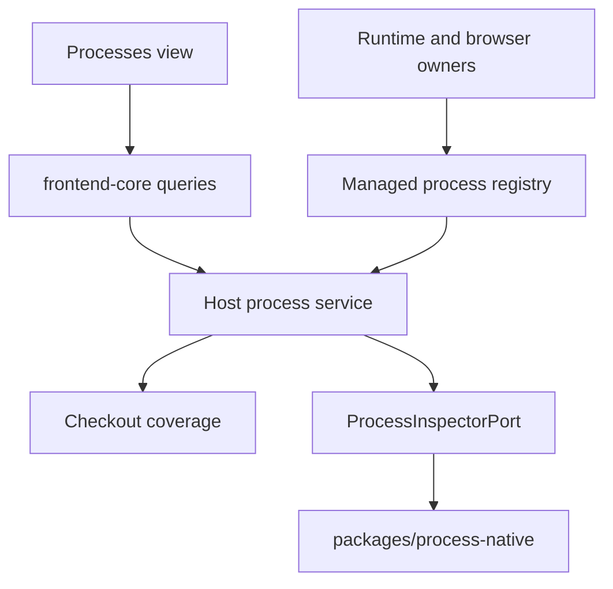

# Processes view

The Processes view shows the commands that run in the checkouts of the open workspaces. A user can open the local URL of a listening port, or stop a command with the processes that it started. The view uses live host data and saves nothing.

Only a local shell can use the view. `packages/remote-host/src/remote-work-interface.ts` refuses `workspace_processes_list` and `workspace_process_stop` from a remote client.

## Parts

The diagram shows the modules that read and stop processes.

| Module | Path |
| --- | --- |
| Contracts | `packages/contracts/src/workspace-process-schemas.ts` |
| Native module | `packages/process-native` |
| Host port and adapter | `packages/host/src/ports/process-inspector-port.ts`, `packages/host/src/adapters/node/native-process-inspector.ts` |
| Host service | `packages/host/src/application/processes` |
| Managed processes | `packages/host/src/infrastructure/process/managed-processes.ts` |
| Client cache | `packages/frontend-core/src/queries/workspace-processes.ts` |
| View | `packages/frontend/src/components/features/processes` |

## Checkout ownership

The host covers the repository checkout of each open workspace and the registered worktrees that a task or a Workspace Session links. Closed tasks and archived sessions keep their links while the worktree exists.

- A task links a worktree through its managed worktree path, a saved session directory, or a branch that `isRelatedTaskBranch` relates to the task.
- A Workspace Session links the worktree of its working directory.
- The files of Git must confirm each linked worktree in every read. See [Worktree confirmation](#worktree-confirmation).
- A workspace can open a linked worktree, so a Workspace Session can use the main worktree.
- A registered worktree without a confirmed link stays a boundary. Its processes never count for the repository that contains it.
- The nearest `.git` entry at or above the working directory decides the checkout of a process, like the search of Git for the checkout root. A nested repository is not part of the checkout around it.
- Paths compare exactly, also in letter case, because a Windows directory can be case sensitive. This rule is different from `canonicalPathsEqual`, which ignores the letter case of Windows paths for worktree removal. On POSIX, a trailing space or a backslash is part of a name. On Windows, only the separator style and the drive letter case do not count. The native module resolves junctions and links in a Windows working directory first, and gives the case on disk.
- A branch links a task to a worktree only when the checkout has that branch now. When one registration leads to a confirmed checkout, its listed branch is the branch of that checkout. When several registrations lead to one path, such as through a link, the host reads the branch of the checkout with Git.
- A missing worktree path links nothing. When the host cannot read a path for any other reason, the read reports it as partial, and the view shows the partial result instead of the empty state.
- Workspace reads run at once, but their results keep catalog order. The first workspace in catalog order keeps a shared checkout when no workspace uses it as its repository checkout.
- Only a process whose working directory is outside every Git checkout can count by its executable path. No directory from the working directory up to the root may have a `.git` entry.
- When Git or the file system cannot answer for a candidate process, the list hides it and reports a partial result, and Stop refuses it.
- The host reads processes with the permissions of its own account. On macOS and Linux, processes of other accounts are outside the view.

### Worktree confirmation

Git lists a removed worktree until a prune, and a worktree that moved without Git keeps its old registration until `git worktree repair`. The Git adapter reads the Git files of each linked root, without a Git process, in `GitPort.confirmWorktree`:

1. The `.git` entry of the root must name a Git directory. A `.git` file names it in a `gitdir: <path>` line.
2. The `commondir` file of that Git directory must lead to the shared Git directory of the repository.
3. A linked worktree must have its administrative folder in `<shared Git directory>/worktrees`, because Git lists only those folders.
4. The `gitdir` file of the administrative folder must lead back to the root.
5. The main worktree has no `gitdir` file. Its Git directory must be the shared one.

Paths in these files can be relative to the folder that holds the file. A plain directory at a removed worktree path covers nothing, and the read reports it.

### Git processes in one read

A read starts two Git processes for each workspace: `readCheckout` of the repository and `git worktree list`. A third read happens only when several registrations lead to one path. File reads answer all other questions.

A list read reuses the Git roots of a workspace for 30 seconds (`RootsReuse`), so the view, which reads every 2 seconds while open and every 5 seconds while closed, starts no Git process in most reads. A new worktree can take up to 30 seconds to show. A stop always reads the roots again.

One read (`createProcessRead`) also resolves each saved path once and checks each folder for a `.git` entry once (`GitPort.hasGitEntry`). A process gets file reads only when its working directory or executable lies below a listed root.

### Cost of one read

One read lists every process of the machine, so its cost grows with the machine and not with the checkouts.

- The native module reads the working directory of each process on every list. On macOS, it reads the executable and the arguments of an instance once and keeps them while the instance runs the same program: the key is the PID, the identity, and the PID version, which XNU changes on each `exec`, also into a program with the same name. The cache holds only the instances of the last list. Linux counts no `exec`, and `/proc` reads are cheap, so Linux reads the executable and the arguments on every list. On Windows, the reads of the process parameters give the directory and the command line together, so nothing is kept.
- The host finds the checkout of a path by its parent folders in an index of the listed roots, not by a scan of all roots.
- On an Apple silicon Mac with about 1,100 processes, the native list takes about 3.5 ms, and the host work after it about 5 ms. The first list after the host starts reads every executable and argument list, about 11 ms.

## Exclusions

The view never shows these processes:

- The host process, and the shell processes that `shellProcessIds` returns, such as the Electron helpers.
- The processes that started the host or its shell, such as the `npm exec` and the `sh -c` that start the web host. A stop of one of them stops the host.
- The runtime processes that the host starts. Each owner builds its launch with `createRuntimeLaunch` and its npm shim resolver, and calls `trackManagedProcess(child, launch.managed)`. The host hides the exact runtime instance, and its project commands stay visible and stoppable. For a Windows batch launcher, see [Windows batch launchers](#windows-batch-launchers).
- The tools of the host and of each agent runtime, and their descendants. A tool is a direct child that is not a shell or a sandbox wrapper and that reads its standard input from a pipe or a socket. The stdio transports of MCP and LSP require that input, so MCP servers and language servers are tools. The host talks to Git the same way. `runsAgentCommand` names the shells and the Codex sandbox wrappers: `sandbox-exec`, `codex-linux-sandbox`, and `codex-command-runner`.
- The agent runtimes themselves. The host knows its own runtimes from `trackManagedProcess`. `isAgentRuntimeServer` knows the runtimes of another app by their arguments: `opencode serve`, `codex app-server`, and Claude Code with `--input-format stream-json`.

The commands of an agent stay visible. Claude Code and OpenCode run them through a shell. Codex runs them directly, so `pnpm dev` is a direct child of `codex app-server`, and its input is `/dev/null` or a terminal. A command that detaches from its shell belongs to init and counts by its working directory. When the native module cannot read the input of a direct child, the row stays visible and Stop is off. `readStandardInputs` reads the input kind on every system: `/proc/<pid>/fd/0` on Linux, descriptor 0 from libproc on macOS, and the standard input handle on Windows.
- Host infrastructure, such as the browser engine, and all its descendants. Its owner calls `trackManagedProcess(child, { kind: "infrastructure" })`.
- The OpenDucktor MCP server that a runtime starts, and its descendants. The host knows it by the last part of the resolved MCP command: the sidecar executable or the MCP script. When the host cannot resolve that command, the list reports an issue and Stop is off for each row, because an MCP server can then look like a project command.
- Interactive shells that wait for input. A shell that runs `-c`, a script, or a command stays visible.

A new long-lived child process of the host must call `trackManagedProcess`.

## Commands

The view shows commands, not single processes, because a user starts a command, such as `pnpm dev` in `apps/web`, and that command starts more processes.

- Each row sets `parentRef` to the nearest process of the same checkout in the list that started it. A row without a parent in the list starts a command.
- Each row sets `directory` to its working directory below the checkout, with `/` separators. The view shows it before the command, as a terminal prompt does.
- A command row without a shell parent sets `launcher` to the app that started it, such as `Zed` for a language server. The name is the macOS app bundle or the program name. A shell, a command that is a shell, a command of an agent runtime, and a process whose parent exited set no launcher.

### Windows batch launchers

On Windows, a runtime executable can be a `.cmd` batch launcher, such as an npm shim. `cmd.exe` runs the launcher, and the launcher can start the runtime several levels down.

`createRuntimeLaunch` starts the native binary behind a known npm shim directly, so the host knows the exact runtime PID. Each runtime adapter owns the resolver of its package: `resolveCodexNpmShim` and `resolveOpenCodeNpmShim`. The resolvers follow these rules:

- A global shim serves the `node_modules` folder beside it. A local shim in `node_modules/.bin` serves its parent folder.
- The shim text names the package file that it runs, such as `"%dp0%\node_modules\@openai\codex\bin\codex.js"`. Two packages can install shims with the same name, such as OpenCode 1 and OpenCode 2, so the text decides.
- Codex: the shim runs `node @openai/codex/bin/codex.js`. The host finds the same binary as that script, in the `@openai/codex-win32-<arch>` package that Node resolves from the script, or else in `@openai/codex`. The binary is `vendor/<target>/bin/codex.exe`, or `vendor/<target>/codex/codex.exe` in releases up to 0.132.
- Codex: the host sets the environment that `codex.js` sets. `CODEX_MANAGED_PACKAGE_ROOT` is the real path of `@openai/codex`. The helper tool folder (`vendor/<target>/codex-path`, or `vendor/<target>/path` in older releases) goes first on the search path when it exists. Newer binaries find that folder themselves.
- Codex: `CODEX_MANAGED_BY_PNPM` is `1` when the `node_modules` folder has `.modules.yaml`, and `CODEX_MANAGED_BY_NPM` is `1` otherwise. `codex.js` also reads the environment of its caller, such as `npm_config_user_agent`. The host does not copy those checks, because its own environment does not tell how Codex was installed. The value changes only the update command that Codex suggests.
- OpenCode 2: the shim runs `@opencode/cli/bin/opencode.exe`, which is the binary itself.
- When the package has no binary for the host architecture, the host runs the shim, and the shim reports the install problem.

The host tracks any other batch launcher as `runtime_launcher`:

- Each launcher level and the runtime inherit the standard input pipe that the host serves.
- The native module reads the input handle of each descendant and asks Windows which process serves its pipe (`GetNamedPipeServerProcessId`), in the same `readStandardInputs` call that finds the tools.
- A descendant whose input pipe the host serves is a launcher level or the runtime, so it is hidden.
- A launcher can relay the input in other ways, such as a pipe of its own or a Node IPC channel. Thus the process graph never proves where the runtime ends.
- Every other descendant of the launcher stays visible, but Stop is off and the row shows the reason.
- The walk visits each process once. It ignores a parent PID that a later process took: a child that started before its parent does not belong to it.

## Stop

A stop request sends the exact checkout path from the list. The host does not trim it.

A stop request names the workspace, the checkout, and the process references. The host reads the links and the processes again once for the request, before it signals. It stops only the same process instances in the same checkout, and it signals them together, as Ctrl+C stops a command in a terminal. The response gives one result for each process.

| System | Signal |
| --- | --- |
| Linux 5.3 and later | `SIGTERM` through a pidfd |
| macOS 14 and later | `SIGTERM` through `proc_signal_with_audittoken`, which checks the PID generation |
| Windows | `TerminateProcess` on the process handle that the final checks used |
| Older Linux and macOS | `SIGTERM` to the PID after a final identity check |

On the older systems, the row sets `requiresPidReuseAcknowledgment`. The confirmation shows the PID reuse warning, and the request must send `acknowledgedPidReuseRisk: true`. The host sends that consent to the native module as `allowPidSignal`. The native module knows the signal mode, so it alone refuses a PID signal without consent.

On Windows, the row sets `forced`, because `TerminateProcess` ends the process at once. The confirmation then says that each process cannot save its work.

The host holds one pending stop for each process instance. The native module waits for the exit on its own thread, not on a thread of the libuv pool. It waits up to 5 seconds and reports `stopped`, `already_exited`, `still_running`, `unconfirmed`, `out_of_date`, or `pending`.

## View

The user checks the processes while working on something else, so no surface takes the page or blocks the app.

| Level | Surface | What it shows |
| --- | --- | --- |
| Ambient | Badge on the Processes button of the rail | The number of running commands, while the flyout and the window are closed |
| Ambient | Ports button in the task sheet and the Agent Studio header | The number of web ports of the task. A click lists the ports, and each one opens its URL. ArrowUp and ArrowDown move between the ports. Without a web port, the button does not show. |
| Glance | Flyout beside the rail button | The list. The app stays usable. A click outside or Escape closes it. |
| Detach | Floating window over the app | The same list, until the user closes it or attaches it back to the rail |

- `ProcessesProvider` in `ApplicationOverlays` owns the view state and one read of all open workspaces. The read runs every 2 seconds while the flyout or the window is open and the app shows. While both are closed, it runs every 5 seconds and only while the app window has the focus, so a stopped command leaves the badge within 5 seconds. When the window gets the focus back, the read runs at once. Every other reader watches the cache only, so the badge and the ports buttons start no read. Readers take the actions, the view state, and the place of the floating window from three contexts, so a ports button or a command of the palette does not render again when the view opens, closes, or moves. The panel reads the open workspaces from `useWorkspaceScope`, so a branch refresh does not render the list again.
- The rail button, the `processes` shortcut, and the command palette open and close the view as the user left it: the flyout or the window.
- Detach turns the flyout into a [floating window](frontend-guidelines.md#floating-windows) at the same place. The window stays across navigation, moves by its title bar, and resizes from each edge and corner. Attach turns it back into the flyout. The mode, the place, and the size live in memory only, so a reload closes the window.
- The checkouts of the current task come first with a `This task` tag: the task of Agent Studio. The other checkouts of the active workspace follow. Other workspaces start folded.
- One toolbar holds the "Search commands" field, a live dot with the counts, such as `2 commands · 2 ports` or `1 of 2 commands` while a filter is active, a note for a partial read, Detach or Attach, and Close. In the window, Attach and Close are in the title bar of the window, which also moves it.
- A detached process stays in the list after its command stops, such as the `turbo daemon` that `turbo run dev` starts. It is a real process, and Stop ends it.
- The list keeps a minimum height of 240 pixels in the flyout. Its scrollbar floats over the list, so a list that grows or shrinks never moves a line. Commands keep their start order and checkouts keep the host order, so a refresh never moves a line that stays.
- Each command takes one line: its folder, the command, all its ports, and Stop. The list never scrolls sideways. In a line narrower than 24rem, the ports fold into one button with their count, so Stop always shows. The button opens the list of the ports. Copy hides in such a line. A command that a shell runs, such as `zsh -lc "pnpm dev"`, shows the inner command. A shell that runs one program shows that program, so a command that an agent wraps in a script, such as the `zsh -c "source snapshot.sh && eval 'pnpm dev'"` of Claude Code, reads like the typed one. Paths below the working directory or the checkout become relative, and a path inside a package starts at the package, such as `vite/bin/vite.js`. The full command shows in the title.
- A press on a command opens its details: each process with its PID and its command, below the process that started it. Each process shows its ports, and Copy and Stop show on hover.
- Stop on a command stops every process of the command that may stop. It asks for confirmation in a popover beside the button, with the folder, the process count, and the ports. The popover warns only about a forced stop on Windows or a PID-only stop.
- The processes that another app started without a shell fold behind one line for each app, such as `Zed · 7 processes`, below the commands. Each of them stops alone.
- Each checkout has a header that stays at the top while its commands scroll. A press on the header folds the checkout, and a folded header shows the ports and the process count.
- The filter field takes the focus when the flyout or the window opens. It matches the name, the command, the folder, the PID, and the ports, and it opens every checkout. Each word must match, in any order and in any process of the command, so `web 5173` finds the web dev server. Results change at once, with no motion, and the motion of a refresh comes back 300 ms after the last change. A command stays whole when one of its processes matches, and it opens when the match is below its first process. Enter opens the first matching web port, which shows `↵`. ArrowDown moves the focus to the first command, ArrowUp and ArrowDown move between commands, and ArrowRight and ArrowLeft open and close one. The first Escape clears the filter, and the next one closes the flyout. Escape does not close the window.
- A partial read shows one note in the footer. Its details open in a popover. A workspace whose repository folder no longer exists is not a partial read, because no process can run in it.
- Commands and checkouts grow in when a refresh finds them and fold away when they stop, with the `css-presence` motion. A stopped command folds away without a toast.

## Out-of-date rows

`packages/frontend-core/src/queries/workspace-processes.ts` keeps the stop state of each connection, so the flyout and the window show it too.

- A pending stop shows on its row and turns off a second stop.
- When the host cannot confirm a stop outcome, the row gets a mark. Only a host read that started after the mark clears it. Other cache edits keep the mark.

## Browser links

The host builds the URL from the listener address and port. It maps `0.0.0.0` to `127.0.0.1` and `::` to `[::1]`.

- Python `http.server` is HTTP, or HTTPS with `--tls-cert` in any form that argparse accepts.
- A PostgreSQL server is not a web server.
- Any other listener gets an HTTP suggestion. The button shows the address and the port that it opens, because a wildcard bind opens a loopback URL. Its title says when HTTP is a guess.
- A port that browsers block, from the Fetch standard list, has no link.

Electron opens the URL with its shell. The web runner sends `open_external_url`, so the host reports a failure. On Windows, the host opens URLs with `ShellExecuteExW` from the native module.

## Native module

`packages/process-native` is a Rust Node-API module. It reports system facts and does the checked stop. The host makes every decision.

| Path | Holds |
| --- | --- |
| `src/lib.rs` | The Node-API functions. Each one turns a panic into an error, because a panic in a Node-API callback stops the host process. |
| `src/model.rs` | The values that cross the boundary. `src/index.ts` declares the same shapes. |
| `src/issues.rs` | The issue and outcome texts of system errors. |
| `src/parse` | The pure parsers of the system data formats. Every target builds and tests them with byte fixtures. |
| `src/unix` | The list loop, the details cache, and the inspection that Linux and macOS share, and the system calls of each. |
| `src/windows.rs` | The Windows system calls. Compile-time checks compare the port table layout with the `windows-sys` structs. |

Follow these rules when you change the module:

- Parse system bytes in `src/parse`, and keep the system calls in the platform modules.
- Give each `unsafe` block one unsafe operation and a `// SAFETY:` comment. The `[lints]` table of `Cargo.toml` enforces this rule, the pedantic Clippy group, and no `unwrap`, `expect`, or slice indexing outside tests.
- Hold each descriptor and handle in `OwnedFd`, `OwnedHandle`, or a drop guard.
- Report system failures as `io::Error`. Make text of them only in `issues.rs` or at the Node-API boundary.
- Wait for a process exit on an event: a pidfd on Linux, a kqueue on macOS, and the process handle on Windows. Only a Linux kernel before 5.3 reads the process state at an interval, because it has no exit event.
- Keep `rust-version` in `Cargo.toml` at the oldest Rust that builds the module. Clippy refuses newer APIs.

`bun run --filter @openducktor/process-native lint:rust` runs rustfmt, Clippy, and the Rust tests. To check the other systems from one machine, add their targets with `rustup target add`, then run `cargo clippy --all-targets --target x86_64-unknown-linux-gnu` and `--target x86_64-pc-windows-msvc`.

## Tests

`packages/process-native/src/process-native.test.ts` starts a real server and checks the list, the listener, and the stop on the test machine. CI runs it on Linux, macOS, and Windows. The Rust tests check the parsers, the list loop, and the details cache with fixtures and a fake process source. The host service tests use real Git checkouts and a fake process reader. One test copies the process trees of a real run: the host starts Codex and Claude Code, Codex runs `pnpm dev` directly, Claude Code runs a command through `zsh -c`, and both start MCP servers.
