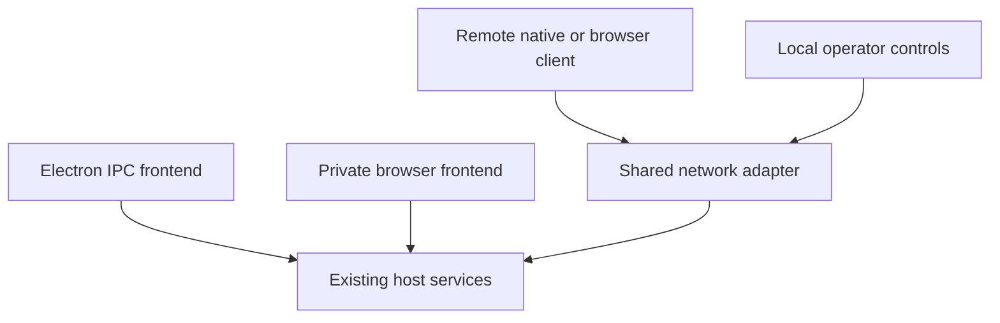

# Remote host protocol

## Clients and hosts

A host runs workspaces, agents, sessions, and terminals. A client shows the work of its selected host.

Electron and the normal web runner select their own local host by default. The standalone web client starts at a host picker and does not start a host.

Select the host icon at the bottom of the workspace rail, left of Settings, to open Host connection. The dialog shows the selected host above the New host address field. Desktop app host and Web runner host name the host supplied by that shell. For a selected local host, the dialog shows whether remote control is on or off. Remote control settings opens that Settings section. When remote control is on, the dialog also shows the sharing address, live client count, Copy address, Show QR code, and Disable remote control. These controls use the same state, change operation, and address view as Remote control settings. A remote host shows its full address once. Paste the address from the other host's Remote control settings, then select Switch host. Use desktop host or Use web runner appears only when that shell has a local host and it is not selected. Host changes sit in the dialog footer, with Cancel on the left. Disconnect returns a remote client to the connection screen. Cancel keeps the selected host. During onboarding, the host icon sits with the header controls.

Selecting the current host does not reload the client. Switching to a different host or disconnecting reloads the window and clears the old host's reads, events, and work state. The client stops local delivery at once and waits for pending admission cleanup before it reloads. Cleanup uses the existing setup and release deadlines. Host work keeps running. Remote drafts stay in the memory of their client connection and are lost on reload or host change. Copy any unsent draft first. Existing local drafts stay on this device.

The standalone client starts at the connection page on its first visit. Use `bun run browser:client` to test this mode. It reads no host settings or work until the connection is ready. The connection page has Light, Dark, and System theme choices and saves its theme in this browser.

The client saves its host choice in this browser's local storage and restores it after reload or a later visit. The address bar contains no selected host. Disconnect saves the connection page as the next startup choice. Remote work routes use the URL hash. Host selection adds no task-store record or schema.

Remote control, app updates, external links, and clipboard functions belong to the local shell even when its client views another host. A standalone client has no local host and does not show Remote control.

See [the web runner guide](web-runner.md#deploy-your-own-copy) for the static client build.

## Access and host ownership

Remote access is an extra entry point to the running Electron or web host.
Both shells use `@openducktor/remote-host` and the same command router, event journal, task and notification streams, terminal service, and resource readers as their local frontend.
Electron keeps its existing renderer and preload IPC.
Closing the Electron window still stops its host and all remote connections.

Remote access is disabled by default.
Network reach grants access to all hosted workspaces and normal host work, without sign-in, passwords, pairing, device approval, or per-device revocation.
The operator must restrict reach with a protected network, such as Tailscale, or a protected HTTPS proxy.
The QR code contains the same work address that the operator can copy.
It contains no credential and creates no trust record.

The shell owns the host, and the network adapter owns its listener and connections.



## Enable and disable

Open Settings, Remote control in the local frontend.
This page lets other devices access the current OpenDucktor instance.
Choose the network that the other device can reach, then select Enable remote control.
The host lists its own network addresses and uses IPv4 when that network has it, or unscoped IPv6 otherwise.
Loopback and scoped link-local addresses do not appear in this list.
The operating system chooses a free port, and the host builds the full connection address from the bound port.
The default address is the listener origin, such as `http://192.168.1.9:14328`. Users do not add a `/remote` suffix.
Copy the address into a compatible OpenDucktor client, or show its QR code in a separate dialog.
A browser opened at the host address shows its descriptor as JSON. To use the full app, open a standalone web client and paste the host address into its picker.
The On status means the listener started; it does not prove that a phone can reach it.
The local host uses a laptop icon. It uses the running-session color when remote control is on and gains a small dot when external clients connect. The tooltip gives the client count. Each client with a live event, task, or terminal stream counts once. Disconnecting its last stream clears it from the count. Operator status updates use the existing live status subscription.
Advanced contains an optional fixed port, local listen address, and public host address.
Choose a fixed port only when a firewall or proxy mapping needs one.
An explicit public host address requires a fixed port.
The local listen address selects which network accepts connections; a wildcard or loopback listen address needs an explicit reachable public host address.
The public host address sets the copied address, QR code, allowed hostname and browser origin, and optional path prefix. It does not configure a proxy.
Invalid fields show a readable error before the listener starts.
An invalid endpoint or a bind failure leaves local host work usable and shows a configuration failure.
Select Disable remote control to stop admission and end every remote attachment.
Disablement also closes pending remote HTTP responses and active transfers on a shared listener.
Accepted commands continue under the host's command lifetime.
Terminal client cleanup detaches observers; it does not close a shared PTY.

Each shell accepts this startup configuration:

```sh
OPENDUCKTOR_REMOTE_HOST=100.64.0.1
OPENDUCKTOR_REMOTE_PORT=14328
OPENDUCKTOR_REMOTE_ENDPOINT=http://100.64.0.1:14328
```

Supply all three values to request enablement.
A partial or invalid configuration shows a remote failure.
Operator changes apply only to the current run.
Enable and disable take effect immediately.
A restart restores the supplied startup configuration or starts disabled.
No remote settings, connection IDs, or device records enter durable storage.
Use a stable port or proxy mapping if clients must reconnect to the same address after restart.
In the local operator contract, `listenPort: 0` requests an automatic port and remains zero in `configuration` to keep that choice when the page reopens.
The returned `configuration.publicEndpoint` always contains the resolved connection address.
The private network-list route is `GET /remote-access/networks`; remote clients cannot use it.

The endpoint must use `http` or `https`, include the work mount path, and contain no credentials, query, fragment, wildcard, loopback hostname, or zero port.
Direct HTTP access needs the mobile platform's cleartext-network permission.
The native app owns that platform setup.
HTTPS clients must validate certificates; they must not downgrade to HTTP or ignore certificate failures.

## Web entry points and proxies

The normal launcher needs no network parameters to open Remote control or Host connection. Enabling Remote control starts a separate work listener while the local frontend stays private. It does not publish the browser UI.

The work listener accepts `https://app.openducktor.dev`, loopback web client origins, packaged Electron's opaque origin, and its own public origin. Add another static web deployment's origin in Advanced, Other web clients. An origin contains the scheme, hostname, and optional port, with no path or trailing slash. This allowlist applies to HTTP and terminal WebSocket requests. Unlisted browser origins get a `403` response.

An HTTPS web client must use an HTTPS host endpoint. A native client can use HTTP if its platform permits it. Hosting the client and exposing the host are separate operations.

A non-loopback web `--host` or `--external-url` enables remote browser mode.
Network browser pages and their work endpoints require HTTPS.
The launcher rejects an HTTP browser origin or explicit work endpoint before it starts services.
The launcher prints a separate loopback Local operator URL and serves local configuration there.
The network browser configuration contains the remote work endpoint and no launcher or local app token.
Remote browsers cannot enable, disable, update, install, or stop the shell.
Loopback-only HTTPS and proxy configurations keep local browser mode.

Existing `--host`, `--external-url`, `--backend-port`, and `--base-path` options still define the network URLs.
The remote endpoint uses the browser backend URL without an added path suffix.
Use `--remote-endpoint` for a different complete proxy work endpoint.
Explicit `--host`, `--backend-port`, and `--remote-endpoint` values override `OPENDUCKTOR_REMOTE_HOST`, `OPENDUCKTOR_REMOTE_PORT`, and `OPENDUCKTOR_REMOTE_ENDPOINT` in both browser modes.
These overrides do not enable remote access in an otherwise local run without remote startup values.
When the remote and private bind addresses and ports match, their separate request handlers share the existing private HTTP listener.
Private app-session requests keep their existing protection and URLs.
Explicit remote admission always selects the remote handler, even when private credentials are also present.
Without remote admission, local app or control credentials select the protected private handler; other requests select the remote handler with the configured prefix or its stripped proxy mapping.
Disabling remote access removes remote admissions and attachments while the private listener remains available.
The launcher resolves an OS-assigned backend port before publishing the remote endpoint.

For this command, clients use `https://machine.ts.net/api`:

```sh
npx @openducktor/web --host 127.0.0.1 \
  --external-url https://machine.ts.net --base-path /api \
  --backend-port 14327
```

Forward `/api` and its child routes to the remote listener at `127.0.0.1:14327`.
The proxy can retain the complete configured endpoint prefix or strip it to `/`.
Forward the frontend origin to its frontend port.
Do not forward the private local backend or its `/remote-access` and launcher routes.
Disable SSE buffering, allow streaming responses, and forward terminal WebSocket upgrades and offered subprotocols.
Do not redirect work requests; configure clients with the final endpoint.
Keep the configured browser origin and Host header in the allowlists.
Native HTTP requests can omit Origin; browser headers do not identify a device.

## Compatibility

Remote protocol `1` is independent of app release versions.
Hosts and clients can use different app versions when they share a protocol version and the client receives all required capabilities.
A breaking change to required behavior needs a new remote protocol version.
An additive optional capability can keep protocol `1`.

| Baseline capability | Meaning |
|---|---|
| `host.work.v1` | Host reads and commands for workspaces, tasks, sessions, queues, runtime actions, history, and staging. |
| `host.events.v1` | Host, task, notification, workspace, and runtime updates. |
| `agent.live.v1` | Live session snapshots, ordered changes, context, pending input, and replies. |
| `terminal.v2` | Shared terminal creation, observation, attachment, input, resize, acknowledgements, and output recovery. |
| `work.resources.v1` | Registered task assets and staged attachment previews. |

Discovery returns `shell`, `appVersion`, `hostInstanceId`, `accessPolicy: "network_reach"`, and supported protocol versions with capability names.
`hostInstanceId` identifies the live host run; it is not a durable trust identity.
Negotiation sends this client hello:

```json
{
  "appVersion": "mobile-release",
  "supportedProtocolVersions": [1],
  "requiredCapabilities": ["host.work.v1", "host.events.v1", "agent.live.v1", "terminal.v2", "work.resources.v1"],
  "optionalCapabilities": []
}
```

Acceptance returns the descriptor, selected protocol, transient `connectionId`, and missing optional capabilities.
A protocol mismatch names both app versions and supported protocols and states which side needs an update.
A missing required capability refuses admission and names that capability.
Missing optional capabilities leave admission usable; their unsupported functions report `function_unavailable`.
Runtime readiness remains a separate host failure.
Clients use host commands for runtime work; a host runtime's loopback route is never their network target.

## Work routes

Let `R` be the complete work endpoint.
Every work request, resource, stream, lease operation, and terminal upgrade must resolve a current negotiated connection.
All HTTP clients send `x-openducktor-connection-id`.
Negotiation does not set a cookie, and cookies cannot select a remote connection.
Connection IDs remain in memory and expire after 60 seconds without requests or active streams.
The host bounds admissions to 128 and task leases to 32 per connection.
The ID records compatibility, not device authorization; any reachable compatible client can negotiate a new one.

| Method and route | Contract |
|---|---|
| `GET R` | Discover the host. |
| `POST R/connections` | Negotiate the client hello. |
| `DELETE R/connections/current` | Release this live admission. |
| `POST R/invoke/{command}` | Use existing host command inputs and results. |
| `GET R/events` | Combined host and notification SSE. |
| `POST R/task-events/subscriptions` | Create an owned lease with `subscriptionId` and captured `replayBoundary`. |
| `GET R/task-events/subscriptions/{id}/stream` | Stream existing task frames. |
| `POST R/task-events/subscriptions/{id}/ack` | Acknowledge `{ "cursor": ... }` after applying state. |
| `DELETE R/task-events/subscriptions/{id}` | Release an owned lease. |
| `GET R/terminal` | Upgrade to terminal protocol 2. |
| `GET R/task-assets/{workspaceId}/{taskId}/{scope}/{assetId}` | Read a registered task asset. |
| `GET R/local-attachment-preview?path={stagedPath}` | Resolve and read a staged attachment. |

Mutation requests require JSON.
Command validation, workflow transitions, approvals, selected-runtime resolution, session ownership, and resource limits stay in host services.
A lease ID alone cannot access another connection's task stream.
Resource responses retain the host's access restrictions and private no-store headers.
Shell functions `open_external_url` and `system_open_directory_in_tool` are unavailable remotely.
Remote `system_list_open_in_tools` calls return an empty list so clients do not offer host applications that they cannot launch.
Launcher shutdown, installation, and updater controls have no remote routes.

Terminal upgrades offer `openducktor-terminal.v2` and `openducktor-connection.<connectionId>`.
The server verifies the connection tag, then selects `openducktor-terminal.v2`.
An explicit connection header must agree with the tag.
Browser WebSockets cannot set request headers, so each tab sends its connection ID in the tag.
Native upgrades can omit Origin or use the configured public endpoint origin.
Use the same terminal ID and last consumed sequence to attach to a surviving PTY.
Keep terminal protocol backpressure, replay, screen restore, overflow, and lost-handle meanings unchanged.

| HTTP status | Meaning |
|---|---|
| `400` | Malformed protocol or request. |
| `409` | Missing capability, expired admission, or unavailable function. |
| `426` | No shared protocol version. |
| `503` | Disabled or unavailable admission. |

A structured `RemoteFailure` contains `code`, `message`, and `nextAction`, with compatibility metadata when needed.
Host command failures preserve `HostInvokeFailure`, including accepted and partial outcomes.
If an Electron command fails and its error log also fails, the remote response reports the logging failure and keeps the command outcome data.
An unreachable endpoint cannot explain whether the host stopped, remote access was disabled, or the network failed.
Report only the evidence the platform supplies.

## Portable client and recovery

Remote browser task assets and staged previews use the current client's admission header. The browser bridge returns Blob data with the host's media type. TanStack Query shares each resource read while views use it, and removes inactive resource data with `gcTime: 0`. Each view creates its own Blob URL and revokes it when its source changes or the view closes. Closing the last view also cancels an unfinished resource read. These reads keep the existing asset and staged-file limits and access checks.

Resource query keys include the connection generation. A new admission starts new resource reads. A resource failure stays visible in its view and does not fail the current-work recovery barrier. Electron and the private browser keep their existing resource URLs and IPC or local HTTP delivery.

A client app uses `createRemoteHostConnection` from `@openducktor/frontend-core/recovery/remote-host-connection`.
Supply the endpoint, the client app version, a `RemoteTransport`, and the query client of the same `ClientConnection`.
It wraps `createRemoteHostClient` from `@openducktor/host-client/remote` and owns the recovery barrier below: task stream owners, live attachments, registered platform owners, the notification replay relay, and the refetch of active reads.
Pass the result as the host of `createClientConnection`, with `releaseHost` set to disconnect the remote client. Disposing the connection releases the admission and sends no host command.
A remote host stores drafts in connection memory, so two hosts never read each other's drafts, even with identical repository paths. Set `saveDraftsOnDispose: false` for this storage, so disposal does not wait for draft attachment uploads.
Electron and the browser use the same module through `createRemoteShellBridge`.
The portable entry point uses no React, DOM, EventSource, Node API, browser cookie bootstrap, or runtime SDK.
A native adapter can supply streaming HTTP, such as `expo/fetch`, and its platform terminal socket factory.
The native app must supply redirect rejection, normal certificate validation, cancellation, and binary terminal frames.
A standard JavaScript socket factory alone does not prove native redirect rejection.
This change does not include Expo screens or native platform configuration.

Subscribe to state, host events, and notifications before `connect()`.
The connection reports `connected` after compatible admission, host replay completion, notification attachment, and application synchronization.
The synchronizer receives the generation, AbortSignal, current descriptor, previous host instance ID, and host replay gap information.
Restore selected task streams and live or terminal attachments before current-state reads.
Await owned task `ready` promises only after state application has acknowledged the captured replay boundary or its replacement snapshot boundary.
Later live events do not extend that barrier.
The remote host connection uses the task and live-session state owners, the notification replay relay, and the active TanStack Query reads of its own client connection.
Recovery does not refetch reads that set `meta: { skipHostRecovery: true }`, such as resource reads and the remote access state of this device.
After a failed first attempt, the first successful admission also recovers mounted state owners, even when no previous host instance ID exists. Fresh bootstrap reads keep their initial path so they do not wait on their own connection barrier.
Reconnect listeners return the recovery promises that must finish before remote work unlocks.
The runtime status owner returns its baseline recovery because its Query observer does not fetch on its own.
Recovery waits for the latest owned baseline if a host event replaces the read, and a failed baseline fails the connection.
Autopilot returns its held-outcome read and application.
Selected terminal owners join synchronization through `subscribeRecovery` before current-state reads.
They wait for the attachment snapshot and consumption through its output boundary, or an explicit lost-terminal result.
Later output does not extend that boundary, and terminal restoration fails after a 10-second deadline or a protocol failure.

Discovery, negotiation, resource and lease responses, and stream or terminal setup have bounded deadlines.
Host commands use the connection's cancellation signal and have no fixed client deadline.
The host sends the command response when work completes.
The client reports state and event listener errors without stopping connection or event delivery.
Established streams remain event-driven.
Changing browser tabs keeps the live host connection and work state. One page owner pauses a remote connection in the browser's back/forward cache and resumes it when visible. Notification owners stay alive during that pause.

A cached page reloads if the selected host changed or its previous client was released. Local clients release their owners on cache entry and rebuild on history restore. Leaving the page closes the client and its notification owners.
Transport loss cancels old-generation handles and permits active reconnect with exponential backoff capped at 15 seconds, or manual `retry()`.
`setActive(false)` and `disconnect()` cancel attempts.
Permanent endpoint, protocol, capability, TLS, and synchronization failures require correction and explicit retry.
Same-host reconnect resumes retained cursors; a replay gap requires the affected current state.
A new host instance replaces stale live state and old handles.

Terminal owners receive connection loss and can reattach to surviving terminals.
After host restart, old terminal IDs report loss; clients must not recreate the terminal or replay its input.
A lost command result or terminal input delivery reports `outcome_unknown`.
Read current host state to establish its outcome when possible.
Never resend a mutation or terminal input automatically.
