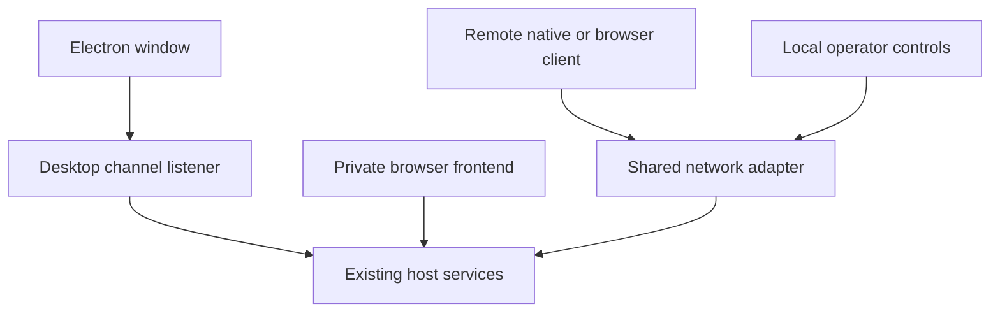

# Remote host protocol

## Clients and hosts

A host runs workspaces, agents, sessions, and terminals. A client shows the work of its selected host.

Electron and the normal web runner select their own local host by default. The standalone web client starts at a host picker and does not start a host.

Select the host icon at the bottom of the workspace rail, left of Settings, to open Host connection. The connection form shows the current host and a Host address field. Desktop app host and Web runner host name the host supplied by that shell. Enter the address and the pairing code that the other host shows after Add device. Typing the sixth digit connects; a change to one digit of a full code waits for Connect. Select a digit to replace it. The client first connects once to check the host, pairs and saves the access when a code is given, and releases that connection. A failure stays in the form with its reason and next action. A success shows Connected for one second, then the page opens the host with the saved access. A paired client leaves the code empty. Use desktop host or Use web runner appears only when that shell has a local host and it is not selected. Host changes sit in the dialog footer, with Cancel on the left. Disconnect returns a remote client to the connection screen. Cancel keeps the current host. During onboarding, the host icon sits with the header controls.

For a selected local host, the Remote control and Connect to a host tabs separate sharing from host selection. Remote control opens first, because the host icon shows its status. While sharing is off, the tab shows the network list with the saved or only network chosen, and Turn on remote control starts sharing on that network. While sharing is on, the tab shows the sharing switch, the live client count, Add device, and the paired devices. Network settings opens Remote control in Settings. These controls use the same host state and operations as Settings.

Connecting to the current host again reloads the window, for example after a new pairing. Switching to a different host or disconnecting also reloads the window and clears the old host's reads, events, and work state. The client stops local delivery at once and waits for pending admission cleanup before it reloads. Cleanup uses the existing setup deadline. A lease release waits for the host answer or for the loss of the channel. Host work keeps running. Remote drafts stay in the memory of their client connection and are lost on reload or host change. Copy any unsent draft first. Existing local drafts stay on this device.

The standalone client starts at the connection page on its first visit. Use `bun run browser:client` to test this mode. It reads no host settings or work until the connection is ready. The connection page has Light, Dark, and System theme choices and saves its theme in this browser.

The client saves its host choice in this browser's local storage and restores it after reload or a later visit. The address bar contains no selected host. Disconnect saves the connection page as the next startup choice. Remote work routes use the URL hash. Host selection adds no task-store record or schema.

Remote control, app updates, external links, and clipboard functions belong to the local shell even when its client views another host. A standalone client has no local host and does not show Remote control.

See [the web runner guide](web-runner.md#deploy-your-own-copy) for the static client build.

## Access and host ownership

Remote access is an extra entry point to the running Electron or web host.
Both shells use `@openducktor/remote-host` and the same command router, event journal, host channel, task and notification streams, terminal service, and resource readers as their local frontend.
Each Electron window opens the host channel of its own host on a loopback listener. Preload IPC keeps only shell functions, such as terminals, browser tabs, updates, and notifications.
Closing the Electron window still stops its host and all remote connections.

Remote access is disabled by default. No pairing code exists until the local operator selects Add device. Add device opens a pairing window with one six-digit code that approves one new client. The window closes when a client pairs, after five minutes, after five wrong codes, when the operator selects Stop pairing, or when Remote control stops. The operator state reports why the last window closed in `pairingEnd`: `paired`, `expired`, `refused` after five wrong codes, or `stopped`. While the operator keeps the pairing view open, an expired code gets a new one at once, and the old code stays dimmed until the new one arrives. A pairing shows Device paired, and five wrong codes show why pairing stopped. A closed window refuses every code, so code guessing never outlasts one operator request. The view asks for the next code with `startPairing({ renew: true })`. A renewal of an open or expired window keeps the count of wrong codes, so a view that stays open gives no fresh guesses. Add device sends no `renew` and starts a new count. Approval needs no separate host click. The pairing view shows two numbered steps: the host address with Copy, then the code. The QR code tab shows the same address and code for the mobile app, and the QR code is created only when the operator opens that tab. Copy address copies no secret. Pairing QR codes contain the address and current code, never a saved credential.

Sharing a code grants control of the host's workspaces, agents, and terminals. Unprotected HTTP can expose pairing codes, access credentials, and host data. Anyone who intercepts the codes or credentials can use this host. Use HTTPS or a protected network.

The host and client save each approval. Browser and desktop clients use a separate versioned localStorage entry per canonical endpoint. Mobile uses Expo SecureStore per saved host. Reload, restart, network loss, and mobile suspension reuse saved access. Disconnecting or switching hosts keeps approval. Removing a mobile host deletes its device data and credential. Revoked or damaged access requests a new code without dropping the entered address. On browser and desktop clients, the Pair with host page uses the same code field, alert, and Connected view as the connect screen: it pairs, shows Connected for one second, and then the connection reconnects with the new saved access.

Only local operator controls show codes and approved clients. Remote control settings lists connected and offline approvals. Each entry has the reported app kind, such as Mobile app or Web browser, and a unique short reference. The app kind does not verify a physical device. Remove deletes the approval before closing every admission on this host and ending its delivery. Other clients and accepted host work continue. Disablement discards codes and live admissions but retains remembered approvals.

Approvals use one stable scope per shell, development instance when present, and host profile. `OPENDUCKTOR_HOST_PROFILE` defaults to `default` and accepts `[a-z0-9][a-z0-9_-]{0,63}`. Hosts of the same shell and profile share one identity and one approval list. Every admission reads its approval from disk, so a removal applies to both hosts at their next negotiation. The other host keeps the device's current connection until then. Use different profiles to keep the approvals of concurrent hosts separate.

The host stores its UUID in `<config-root>/remote-access/hosts/<scope-key>/identity.json` and one immutable approval in `clients/<clientId>.json`. The approval list ignores other files in `clients`, such as `.DS_Store`. The scope key encodes the shell, development instance, and profile tuple. Approval files store the client UUID, reported app kind, and SHA-256 token hash. They contain no reusable secret. Missing or corrupt identity in a populated scope is a storage failure. General settings writes cannot restore a deleted approval.

The shell owns the host, and the network adapter owns its listener and connections.



## Enable and disable

Open Settings, Remote control in the local frontend.
This page lets other devices access the current OpenDucktor instance.
Choose the network that the other device can reach, then turn on Enable Remote Control. Host connection can also turn it on.
The host lists its own network addresses and uses IPv4 when that network has it, or unscoped IPv6 otherwise.
Loopback and scoped link-local addresses do not appear in this list.
The listener uses port `14328` unless the operator enters another port in Advanced.
The default address is the listener origin, such as `http://192.168.1.9:14328`. Users do not add a `/remote` suffix.
Select Add device, copy the address into a compatible OpenDucktor client, and enter the pairing code. The mobile app can scan the QR code instead.
A browser opened at the host address shows its descriptor as JSON. To use the full app, open a standalone web client and paste the host address into its picker.
The On status means the listener started; it does not prove that a phone can reach it.
The local host uses a laptop icon. It uses the running-session color when remote control is on and gains a small dot when external clients connect. The tooltip gives the client count. Each approval with an open host channel or terminal socket counts once, including when several tabs share it. Closing its last socket clears it from the count. Operator status updates use the existing live status subscription.
Advanced contains the port, the local listen address, and the public host address.
When another app uses the port, the page shows `port_in_use` and a "Use another port" action.
That action asks the operating system for a free port, and the host keeps that port from then on.
The local listen address selects which network accepts connections; a wildcard or loopback listen address needs an explicit reachable public host address.
The public host address sets the copied address, QR code, allowed hostname and browser origin, and optional path prefix. It does not configure a proxy.
Invalid fields show a readable error before the listener starts.
An invalid endpoint or a bind failure leaves local host work usable and shows a configuration failure.
Turn off Enable Remote Control to stop admission and end every remote attachment.
Disablement also closes pending remote HTTP responses and active transfers on a shared listener.
Accepted commands continue under the host's command lifetime.
Terminal client cleanup detaches observers; it does not close a shared PTY.

Each shell accepts this startup configuration:

```sh
OPENDUCKTOR_REMOTE_HOST=100.64.0.1
OPENDUCKTOR_REMOTE_PORT=14328
OPENDUCKTOR_REMOTE_ENDPOINT=http://100.64.0.1:14328
```

Supply all three values to request enablement.
A partial or invalid configuration shows a remote failure.
Enable and disable take effect immediately.
The host saves the operator's choices in `remoteAccess` of the settings file: the on or off state and the listener of the last enable, with the port that it bound.
A disable keeps that listener, so the next enable uses the same address.
At start, the host turns remote control on again with the saved listener when it was on.
A saved port that another app took shows `port_in_use`. The host does not choose another port by itself, because the clients know the old address.
Startup configuration from environment variables or launcher options replaces the saved listener for that run and is not saved.
No connection IDs or device records enter durable storage.
In the local operator contract, `listenPort: 0` requests a free port from the operating system.
The returned `configuration` names the bound port, and `configuration.publicEndpoint` always contains the resolved connection address.
While remote control is off or failed, `configuration` is the saved listener, which the next enable uses.
The private network-list route is `GET /remote-access/networks`; remote clients cannot use it.

The endpoint must use `http` or `https`, include the work mount path, and contain no credentials, query, fragment, wildcard, loopback hostname, or zero port.
Direct HTTP access needs the mobile platform's cleartext-network permission.
The native app owns that platform setup.
HTTPS clients must validate certificates; they must not downgrade to HTTP or ignore certificate failures.

## Web entry points and proxies

The normal launcher needs no network parameters to open Remote control or Host connection. Enabling Remote control starts a separate work listener while the local frontend stays private. It does not publish the browser UI.

The work listener accepts `https://app.openducktor.dev`, loopback web client origins, packaged Electron's origins (`null` on HTTP requests and `file://` on WebSocket handshakes), and its own public origin. Add another static web deployment's origin in Advanced, Other web clients. An origin contains the scheme, hostname, and optional port, with no path or trailing slash. This allowlist applies to HTTP requests and to the host channel and terminal WebSockets. Unlisted browser origins get a `403` response. Allowed preflight responses send `access-control-max-age: 600`, so a browser reuses one preflight for up to 10 minutes.

An HTTPS web client must use an HTTPS host endpoint. A native client can use HTTP if its platform permits it. Hosting the client and exposing the host are separate operations.

A non-loopback web `--host` or `--external-url` enables remote browser mode.
Network browser pages and their work endpoints require HTTPS.
The launcher rejects an HTTP browser origin or explicit work endpoint before it starts services.
The launcher prints a separate loopback Local operator URL and serves local configuration there.
The network browser configuration contains the remote work endpoint and no launcher or local app token.
Remote browsers cannot enable, disable, update, install, or stop the shell.
Loopback-only HTTPS and proxy configurations keep local browser mode.

Existing `--host`, `--external-url`, `--backend-port`, and `--base-path` options still define the network URLs.
The remote endpoint uses the browser backend URL without an added path suffix.
Use `--remote-endpoint` for a different complete proxy work endpoint.
Explicit `--host`, `--backend-port`, and `--remote-endpoint` values override `OPENDUCKTOR_REMOTE_HOST`, `OPENDUCKTOR_REMOTE_PORT`, and `OPENDUCKTOR_REMOTE_ENDPOINT` in both browser modes.
These overrides do not enable remote access in an otherwise local run without remote startup values.
When the remote and private bind addresses and ports match, their separate request handlers share the existing private HTTP listener.
Private app-session requests keep their existing protection and URLs.
Remote discovery and negotiation routes, authorization fields, connection tags, and their preflights select the remote handler, including when private credentials are present.
Without remote admission, local app or control credentials select the protected private handler; other requests select the remote handler with the configured prefix or its stripped proxy mapping.
Disabling remote access removes remote admissions and attachments while the private listener remains available.
The launcher resolves an OS-assigned backend port before publishing the remote endpoint.

For this command, clients use `https://machine.ts.net/api`:

```sh
npx @openducktor/web --host 127.0.0.1 \
  --external-url https://machine.ts.net --base-path /api \
  --backend-port 14327
```

Forward `/api` and its child routes to the remote listener at `127.0.0.1:14327`.
The proxy can retain the complete configured endpoint prefix or strip it to `/`.
Forward the frontend origin to its frontend port.
Do not forward the private local backend or its `/remote-access` and launcher routes.
Forward the WebSocket upgrades of `/channel` and `/terminal` with their offered subprotocols, and allow streaming responses for files.
Do not redirect work requests; configure clients with the final endpoint.
Keep the configured browser origin and Host header in the allowlists.
Native HTTP requests can omit Origin; browser headers do not identify a device.

## Compatibility

The current remote protocol is `7`, as `REMOTE_PROTOCOL_VERSION` in `packages/contracts` sets. Version 4 requires full workspace references, typed settings edits, and client authorization, and adds workflow-qualified Autopilot outcomes. Version 5 requires the default target branch in the workspace setup commit and adds the setup target branch read. Version 6 moves commands, host events, notifications, and task event streams from HTTP and SSE to one host channel WebSocket. Version 7 adds the host workflow catalog with its role catalog, and the ordered workspace board. Hosts and clients must use this version together.
The protocol version is independent of app release versions.
Hosts and clients can use different app versions when they share a protocol version and the client receives all required capabilities.
A breaking change to required behavior needs a new remote protocol version.
An additive optional capability keeps the current protocol version.

| Baseline capability | Meaning |
|---|---|
| `host.work.v1` | Host reads and commands for workspaces, tasks, sessions, queues, runtime actions, history, and staging. |
| `host.channel.v1` | The host channel: commands, host events, notifications, task event streams, and heartbeats. |
| `agent.live.v1` | Live session snapshots, ordered changes, context, pending input, and replies. |
| `terminal.v3` | Shared terminal creation, observation, attachment, input, resize, acknowledgements, and output recovery. |
| `work.resources.v1` | Registered task assets and staged attachment previews. |

| Optional capability | Meaning |
|---|---|
| `history.tool_details.v1` | The host reads `toolDetails: "on_demand"` in a session history read and serves `agent_runtime_load_session_tool_part`. See [reply size and compact history](#reply-size-and-compact-history). |

Discovery returns `shell`, `appVersion`, `hostInstanceId`, `hostId`, `accessPolicy: "pairing"`, and supported protocol versions with capability names.
`hostInstanceId` identifies the live host run; it is not a durable trust identity.
`hostId` identifies the host approval scope across restarts. It grants no access. Legacy descriptors can be read only to report which peer needs an update. A remote connection requires protocol 7, pairing support, and a stable scoped host ID before the client sends proof.
Negotiation sends this client hello:

```json
{
  "appVersion": "mobile-release",
  "supportedProtocolVersions": [6],
  "clientKind": "mobile",
  "pairingCode": "123456",
  "requiredCapabilities": ["host.work.v1", "host.channel.v1", "agent.live.v1", "terminal.v3", "work.resources.v1"],
  "optionalCapabilities": ["history.tool_details.v1"]
}
```

Acceptance returns the descriptor, selected protocol, transient `connectionId`, separate live `connectionToken`, and missing optional capabilities. Code approval also returns a host-specific saved grant with `hostId`, `clientId`, and `token`. The client saves it before it opens the host channel. Saved credentials serve negotiation only, through `Authorization: Bearer <saved-token>`, and never return in the response. Submit a code or a saved credential, never both. Neither proof requests code entry. A code without an open pairing window returns `pairing_refused`. The fifth wrong code closes the window. Remembered access remains usable.
A protocol mismatch names both app versions and supported protocols and states which side needs an update.
A missing required capability refuses admission and names that capability.
Missing optional capabilities leave admission usable; their unsupported functions report `function_unavailable`.
Runtime readiness remains a separate host failure.
Clients use host commands for runtime work; a host runtime's loopback route is never their network target.

## Work routes

Let `R` be the complete work endpoint.
Every resource read, host channel, and terminal upgrade must resolve a current negotiated connection.
All HTTP clients send `x-openducktor-connection-id` and `Authorization: Bearer <connectionToken>`.
Negotiation does not set a cookie, and cookies cannot select a remote connection.
Connection IDs remain in memory and expire after 60 seconds without requests or open sockets.
The host bounds admissions to 128 and task leases to 32 per connection.
The ID alone grants no access. Each live token belongs to its admission and remembered approval. A revoked saved credential remains invalid after restart. Codes and credentials never belong in request URLs, logs, or diagnostics.

| Method and route | Contract |
|---|---|
| `GET R` | Discover the host. |
| `POST R/connections` | Check compatibility and one authorization proof. |
| `DELETE R/connections/current` | Release this live admission. |
| `GET R/channel` | Upgrade to the [host channel](#host-channel). |
| `GET R/terminal` | Upgrade to terminal protocol 3. |
| `GET R/task-assets/{workspaceId}/{taskId}/{scope}/{assetId}` | Read a registered task asset. |
| `GET R/local-attachment-preview?path={stagedPath}` | Resolve and read a staged attachment. |

Startup progress uses `openducktor://session-startup-progress` on the host event name `startup`. Each event carries a cumulative operation snapshot. Its replay gap is separate from task, browser, and runtime events. Clients establish the event subscription before they send a tracked startup command.

Remote protocol `3` also carries initial terminal command outcomes in terminal summaries. Terminal frames use protocol `3`. A host and client must both support `terminal.v3`; admission refuses a mismatched version with update guidance.

Command validation, workflow transitions, approvals, selected-runtime resolution, session ownership, and resource limits stay in host services.
A lease ID alone cannot access another connection's task stream.
Resource responses retain the host's access restrictions and private no-store headers.
Shell functions `open_external_url` and `system_open_directory_in_tool` are unavailable remotely.
Remote `system_list_open_in_tools` calls return an empty list so clients do not offer host applications that they cannot launch.
Launcher shutdown, installation, and updater controls have no remote routes.

Socket upgrades offer the route protocol, `openducktor-connection.<connectionId>`, and `openducktor-authorization.<connectionToken>`. The route protocol is `openducktor-channel.v1` for `R/channel` and `openducktor-terminal.v3` for `R/terminal`. The server verifies both tags and selects only the route protocol. HTTP connection and authorization fields, when present, must agree with the tags. Browser and native WebSockets use the live token in the tags. Saved credentials never enter subprotocols or URLs.
Native upgrades can omit Origin or use the configured public endpoint origin.
Use the same terminal ID and last consumed sequence to attach to a surviving PTY.
Keep terminal protocol backpressure, replay, screen restore, overflow, and lost-handle meanings unchanged.

Terminal list observers use `observe_list` with a transient `subscriptionId` and an existing `TerminalListFilter`. The host sends `list_snapshot_start`, one `list_updated` per summary, and `list_snapshot_end`, then sends summary updates and `list_removed` until `unobserve_list` or connection close. A `list_updated` frame carries validated summary JSON in its binary body, because retained Action output can exceed the header limit. A connection can hold at most 32 list subscriptions. List observation attaches to no output and inspects no process. Reconnect sends a replacement snapshot before list recovery completes.

Each host instance assigns a monotonic revision to terminal metadata changes. List responses, snapshot starts, updates, and removals carry that revision. Successful create, Action start, and close replies include the complete list for the terminal's canonical scope. Clients apply the newest revision to their scoped query cache. They discard older HTTP replies and buffered snapshots. A partial summary never advances the list past an earlier unrelated update unless a complete snapshot already includes that update.

| HTTP status | Meaning |
|---|---|
| `400` | Malformed protocol or request. |
| `401` | Pairing or authorization is required or refused. |
| `409` | Missing capability, expired admission, or unavailable function. |
| `426` | No shared protocol version. |
| `503` | Disabled admission, unavailable host, or authorization storage failure. |

A structured `RemoteFailure` contains `code`, `message`, and `nextAction`, with compatibility metadata when needed.
Host command failures preserve `HostInvokeFailure`, including accepted and partial outcomes.
If an Electron command fails and its error log also fails, the remote response reports the logging failure and keeps the command outcome data.
An unreachable endpoint cannot explain whether the host stopped, remote access was disabled, or the network failed.
Report only the evidence the platform supplies.

## Host channel

Each client opens one host channel WebSocket. Remote clients open `R/channel` after admission. The local web runner opens `/channel` with its session cookie. An Electron window opens the `/channel` route of a loopback listener in the Electron main process. That listener serves no other route, checks the renderer origin and the `Host` header, and needs a per-launch token in the `openducktor-authorization.<token>` subprotocol tag. Only OpenDucktor windows get the token, over preload IPC. A packaged window sends the socket origin `file://`; a development window sends the origin of its development server. Browsers allow only six HTTP/1.1 connections per site, and WebSockets do not count against that limit. So one client never blocks the requests of another client of the same host. `packages/contracts/src/host-channel-schemas.ts` defines every message.

The channel uses binary frames of UTF-8 text. Each frame starts with one JSON header. An optional JSON body follows the first line feed. A client reads a body only when it needs it.

The client sends requests and cancels. Each request has a numeric `id`, and the host answers it with a `result` frame, whose body is the result, or an `error` frame.

A result body larger than 256 KiB, `HOST_CHANNEL_RESULT_PART_BYTES`, comes in `result_part` frames, and the `result` frame has the last part. Each part body has the next bytes of the result JSON, so a part can stop inside a UTF-8 character. The client joins the bytes of all parts before it reads the JSON. The host sends the next part only after the socket sends all buffered data. So on a slow link, heartbeats, events, and other replies pass between the parts of a large result, and the client keeps getting frames. After a cancel, the host sends no more parts of that result.

| Request method | Use |
|---|---|
| `events.open` | Send the host event cursor and the notification cursor. The host replays the retained events, answers with `hostEpoch`, `hostEventId`, `hostChanged`, and `gaps`, then sends live events and notification frames. A channel opens events once. |
| `invoke` | Run a host command with its `command` and `args`. |
| `task_events.subscribe` | Create an owned task lease. The result has `subscriptionId` and the captured `replayBoundary`. Frames of the lease follow the result. |
| `task_events.attach` | Deliver an existing owned lease on this socket. The host replays unacknowledged frames. |
| `task_events.ack` | Acknowledge a task cursor after applying state. |
| `task_events.release` | Release an owned lease. |
| `remote_access.observe` | Send the remote access state of the local operator. Remote clients get `function_unavailable`. |
| `remote_access.unobserve` | Stop the remote access state. |

The host also sends `host_event` frames with the event `id` and `name` in the header and the envelope as the body, `notification` frames, `task_frame` frames, `remote_access_state` frames, and a `heartbeat` frame every 15 seconds.

An `error` frame has one of these kinds:

| Kind | Meaning |
|---|---|
| `host` | The host ran the command, and it failed. It carries the `HostErrorResponse`, with `HostInvokeFailure` when known. |
| `refused` | The host ran no work. It carries a `RemoteFailure`, such as `function_unavailable`, `remote_disabled`, `consumer_overflow`, or `connection_expired` for a lost lease. |
| `reply_too_large` | The host ran the command, but its reply is larger than the channel limit. |

A network path, such as a NAT, a proxy, or the Android emulator, can drop an idle socket without closing it. The heartbeat keeps the path busy. A client treats a channel without frames for 45 seconds as a lost connection.

A client can also go away without a close, for example when a phone loses its network. TCP keeps such a socket open for many minutes, and the host would keep its admission, its task leases, and its connected status. So the host sends a WebSocket ping to each channel and terminal socket every 15 seconds. Browsers and React Native answer pings by themselves. When a socket gets no byte for three checks in a row, the host ends it. Bytes of a large message also count, so a slow upload does not end its socket.

The host compresses frames of 1 KiB or more when the client negotiated `permessage-deflate`. Task frames wait while the socket buffers 1 MiB or more and resume when it drains. A client that lets 64 MiB of events queue up cannot keep up, so the host closes its channel with code 1013, and the client reconnects and replays.

A client can stop waiting for a request with an `AbortSignal`, for example at a diagnostics deadline. The client drops the request at once, holds no connection for it, and sends `{ "type": "cancel", "id": ... }`. The host interrupts a running command of `HOST_READ_COMMAND_NAMES`, which runs its cleanup, and sends no answer. A closed socket also interrupts its running reads. A command that can change host state keeps running after a cancel or a socket loss, because an interrupted change can leave partial state. The diagnostics checks `path_check`, `git_check`, and `task_store_check` refresh or prepare host state, so they also keep running.

## Reply size and compact history

A remote host refuses a command reply that is larger than 32 MiB, `REMOTE_MAX_REPLY_BYTES`, with `reply_too_large`. A refused reply to a read fails only that read with `RemoteReplyTooLargeError`, which has the code `consumer_overflow`. A refused reply to a mutation fails with `outcome_unknown`, because the host ran the mutation. The connection stays connected, and the client sends neither command again. Reconnect recovery treats this error as an error of its read, not as a lost connection, so the read's view shows it. This does not apply to the recovery steps that must finish before the connection is ready, such as the live session attach and the task stream setup. An oversized reply in one of these steps still fails the connection attempt. The local web runner has no reply limit. File reads over HTTP keep the 32 MiB client limit.

Session history grows with each tool call, so remote clients ask for compact history. With `toolDetails: "on_demand"`, `agent_runtime_load_session_history` cuts each string longer than 1024 characters in the `input`, `metadata`, `output`, and `resultContent` of a completed or failed tool part to its first 1024 characters. The host sets `detailsOmitted` on each part that it cut. Its `input` flag says that the host cut `input`. Its `output` flag says that the host cut `output`, `resultContent`, or `metadata`. A client shows a loader only in the box of a cut detail. Most row summaries read only the first characters, so they do not change. A summary that shows the `message` or `result` field of a JSON output longer than 1024 characters shows the start of the raw output instead. The full output shows when the user opens the row.

The host keeps these parts and fields whole:

- Running and pending tool parts, because live events still update them.
- Tool types `question`, `todo`, and `file_edit`, because their rows read all their data.
- The outputs of `odt_search_tasks`, `odt_create_task`, `odt_update_task`, and `odt_set_task_artifact`, because their rows parse these outputs.
- `error`, `preview`, `title`, file diffs, file content, and computer use data.

When the user opens a cut detail, the client reads the full part with `agent_runtime_load_session_tool_part`. Its input is the policy-bound session reference with `partId` and `callId`. The host reads the full history and returns the matching part. A part that is no longer in the history fails with `invalid_input`.

The remote client asks for compact history only from a host with `history.tool_details.v1`. It adds `toolDetails` to each history read when it sends the read on such an admission. An older host does not know the field, so the client reads full history from it. Local history stays complete.

## Portable client and recovery

Remote browser task assets and staged previews use the current client's admission header. The browser bridge returns Blob data with the host's media type. TanStack Query shares each resource read while views use it, and removes inactive resource data with `gcTime: 0`. Each view creates its own Blob URL and revokes it when its source changes or the view closes. Closing the last view also cancels an unfinished resource read. These reads keep the existing asset and staged-file limits and access checks.

Resource query keys include the connection generation. A new admission starts new resource reads. A resource failure stays visible in its view and does not fail the current-work recovery barrier. Electron and the private browser keep their existing resource URLs and protocol or local HTTP delivery.

A client app uses `createRemoteHostConnection` from `@openducktor/frontend-core/recovery/remote-host-connection`.
Supply the endpoint, the client app version, a `RemoteTransport`, and the query client of the same `ClientConnection`.
It wraps `createRemoteHostClient` from `@openducktor/host-client/remote` and owns the recovery barrier below: task stream owners, live attachments, registered platform owners, the notification replay relay, and the refetch of active reads.
Pass the result as the host of `createClientConnection`, with `releaseHost` set to disconnect the remote client. Disposing the connection releases the admission and sends no host command.
Desktop and web clients store remote-host drafts in connection memory, so two hosts never read each other's drafts, even with identical repository paths. They set `saveDraftsOnDispose: false` for this storage, so disposal does not wait for draft attachment uploads.
The mobile app stores the drafts of each saved host on the device, in a separate store for that host. Drafts keep the size limits and the 7-day expiry of desktop local drafts and survive app restart, host switch, and connection loss. The app saves the drafts when it goes to the background and before a host switch. Its connection sets `saveDraftsOnDispose: false`, so a removed host or discarded drafts upload no attachment. Removing a saved host deletes its store. See [the mobile app](../apps/mobile/README.md#host-connections).
Electron and the browser use the same module through `createRemoteShellBridge`.
The portable entry point uses no React, DOM, Node API, browser cookie bootstrap, or runtime SDK.
A native adapter can supply streaming HTTP, such as `expo/fetch`, and its platform WebSocket factory for the host channel and terminals.
The native app must supply redirect rejection, normal certificate validation, cancellation, and binary socket frames.
A standard JavaScript socket factory alone does not prove native redirect rejection.
The mobile app in `apps/mobile` supplies these guarantees through its own native HTTP module and the platform WebSocket. [ADR 0012](adr/0012-build-the-mobile-client-as-an-expo-shell-over-frontend-core.md) records the decision.

Subscribe to state, host events, and notifications before `connect()`.
The connection reports `connected` after compatible admission, host replay completion, notification attachment, and application synchronization.
The synchronizer receives the generation, AbortSignal, current descriptor, previous host instance ID, and host replay gap information.
Restore selected task streams and live or terminal attachments before current-state reads.
Await owned task `ready` promises only after state application has acknowledged the captured replay boundary or its replacement snapshot boundary.
Later live events do not extend that barrier.
The remote host connection uses the task and live-session state owners, the notification replay relay, and the active TanStack Query reads of its own client connection.
Recovery does not refetch reads that set `meta: { skipHostRecovery: true }`, such as resource reads and the remote access state of this device.
After a failed first attempt, the first successful admission also recovers mounted state owners, even when no previous host instance ID exists. Fresh bootstrap reads keep their initial path so they do not wait on their own connection barrier.
Reconnect listeners return the recovery promises that must finish before remote work unlocks.
The runtime status owner returns its baseline recovery because its Query observer does not fetch on its own.
Recovery waits for the latest owned baseline if a host event replaces the read, and a failed baseline fails the connection.
Autopilot returns its held-outcome read and application.
Selected terminal owners join synchronization through `subscribeRecovery` before current-state reads.
They wait for the attachment snapshot and consumption through its output boundary, or an explicit lost-terminal result.
Later output does not extend that boundary, and terminal restoration fails after a 10-second deadline or a protocol failure.

Discovery, negotiation, resource responses, and channel or terminal setup have bounded deadlines.
Task stream requests have no fixed deadline, because a large message ahead of their answer can hold it back on a slow link. A channel without frames for 45 seconds is lost, so recovery does not wait forever.
Host commands use the connection's cancellation signal and the caller's optional signal, and have no fixed client deadline.
The host sends the command result when work completes.
The client reports state and event listener errors without stopping connection or event delivery.
Established channels remain event-driven.
A channel that stays silent for three heartbeats is a transport loss.
An HTTP request that the host refuses with `connection_expired` is also a transport loss, because the host no longer knows the admission and ran no work.
Changing browser tabs keeps the live host connection and work state. One page owner pauses a remote connection in the browser's back/forward cache and resumes it when visible. Notification owners stay alive during that pause.

A cached page reloads if the selected host changed or its previous client was released. Local clients release their owners on cache entry and rebuild on history restore. Leaving the page closes the client and its notification owners.
Transport loss cancels old-generation handles and permits active reconnect with exponential backoff capped at 15 seconds, or manual `retry()`.
`setActive(false)` and `disconnect()` cancel attempts.
Permanent endpoint, protocol, capability, TLS, and local network failures require correction and explicit retry.
A synchronization failure retries with the same backoff, and the connection state keeps its failure, so the user can see it.
In synchronization, a recovery read that the host answers with an error shows that error in its view. Only a lost connection fails synchronization.
The browser transport reports `transportCause: "local_network"` when the browser blocks Local Network Access before the host first answers.
Same-host reconnect resumes retained cursors; a replay gap requires the affected current state.
A new host instance replaces stale live state and old handles.

Terminal owners receive connection loss and can reattach to surviving terminals.
After host restart, old terminal IDs report loss; clients must not recreate the terminal or replay its input.
A lost command result or terminal input delivery reports `outcome_unknown`.
Read current host state to establish its outcome when possible.
Never resend a mutation or terminal input automatically.
A command in `HOST_READ_COMMAND_NAMES` only reads host state. After a lost reply, the client waits up to 30 seconds for the reconnect and sends the read again. A host that ends an admission closes its channel, so a refused read also follows the reconnect.
A read sent while the client reconnects by itself waits until it connects, after the recovery barrier. A read of the barrier runs at once.
A result that does not match the command schema reports `invalid_protocol` and keeps the connection.
`confirmEventStream()` resolves true when the host channel delivers a frame by its next heartbeat, and false when it stays silent. A client calls it after a device pause, such as a locked screen, and reconnects on false.
