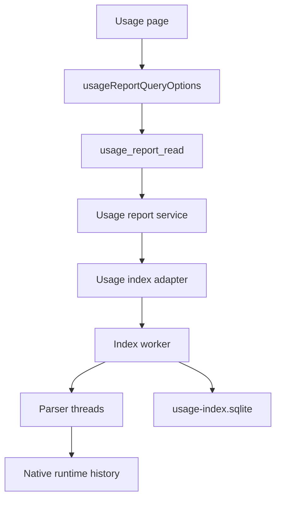
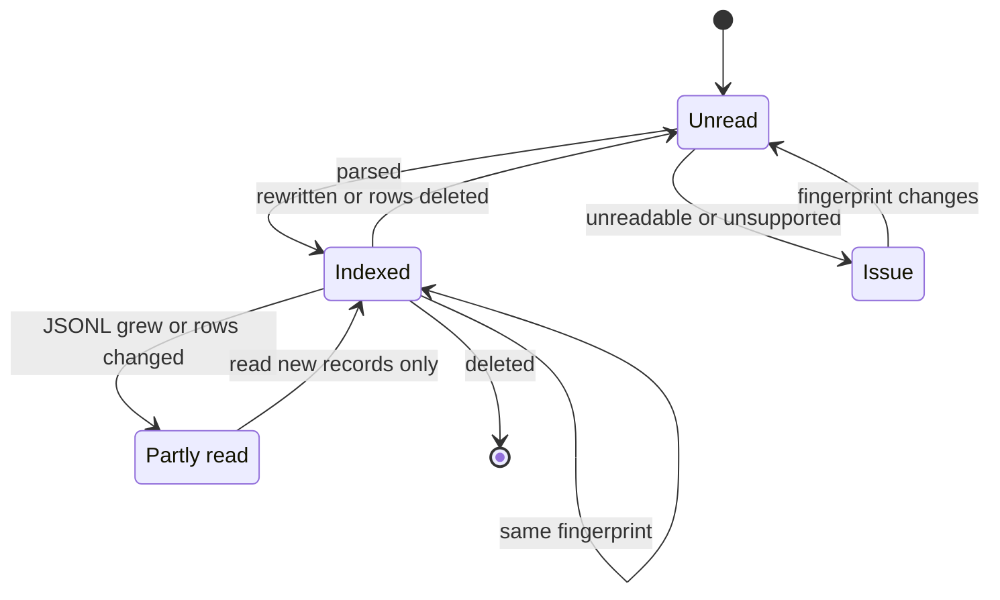

# Usage

The Usage page shows how much the user used Claude Code, Codex, and OpenCode on one host. It reads the native history of each runtime, including sessions that started outside OpenDucktor.

This document gives the data flow, the sources, the counting rules, the rates, and the index.

## Data flow

The page sends one `usage_report_read` command for a selection of a date range and a runtime. The host answers with aggregates and labels only. Paths, transcripts, and raw records stay on the host.

This diagram shows the modules of one read.

| Module | Path | Owns |
|---|---|---|
| Contract | `packages/contracts/src/usage-schemas.ts` | Command input and report schemas |
| Domain | `packages/host/src/domain/usage` | Calendar, periods, rate matching, figures, project rules, and workspace folder ownership |
| Service | `packages/host/src/application/usage` | Range, coverage, labels, figure assembly |
| Adapter | `packages/host/src/adapters/usage` | Threads, parsers, index, rollup. One read (`usage-index-read.ts`) plans the source changes (`usage-sync-plan.ts`), parses on the parser threads (`usage-parse-pool.ts`), and reads the figures in one transaction of the index (`usage-index-store.ts`). The parser (`usage-source-parser.ts`) decides where the read of a source starts. The Codex reader has its line kinds (`usage-codex-lines.ts`), token math (`usage-codex-tokens.ts`), response tracker (`usage-codex-responses.ts`), and record parser (`usage-codex-records.ts`) |
| Query | `packages/frontend-core/src/queries/usage.ts` | Query key and cache |
| Page | `packages/frontend/src/pages/usage` | Filters, overview with the trend chart, tokens by type, breakdown table, sources |

## Threads

- The host thread starts the threads at the first read. They stop together 5 minutes after the index worker reports that it is idle.
- A read checks the sources only when the caller asks for a refresh, or when no check of the last 5 minutes covers its runtimes and range. Otherwise it answers from the index with that check, so a new range or runtime reads in 40 to 120 ms. The page asks for a refresh when it reads a selection that already has a result, such as Refresh. A check stats every source and digests a changed OpenCode database, which takes from 0.1 s to about 1 s.
- The index worker keeps the git data of the recorded folders for the life of its threads, so a report of another range reads git data only for folders that it has not seen.
- A read of an empty index sends a `preparing` progress event before it loads the rates and searches the history, so a client can show the first read at once. Every progress event says with `first` whether it belongs to a first read.
- The index worker owns the index connection, the source check, the commits, the rollup, and the report queries.
- Up to 4 parser threads read sources, and at most half of the cores. They claim jobs through a shared counter, so they never wait for a commit.
- The largest sources start first. The OpenCode database is one long job.
- A canceled read stops new jobs. Jobs in progress finish and commit.
- A read that parses sources sends its progress to the host thread: for each runtime, the share of its parse work and the sessions that it finished out of the sessions to read. A Claude session comes from the transcript path. A Codex rollout names its root session in its first line, which the index worker reads beside the parse. The OpenCode reader reports its own share and sessions: it digests each message table in one pass, which also finds the newest update, then scans both tables in alternating row ID windows of 5,000 rows. A first read digests each window in the same pass, so it reads each table once. A root session is read once the scan of each table passed its last row; a first read gets these last rows from the session index in about 50 ms. A file counts its bytes, a compressed rollout 10 times its size, and each runtime counts alike in the overall share. The tracker sends the runtimes first, then at most one update every 250 ms, and the last update of a burst at the end of the interval. The host publishes it on the `openducktor://usage-index-progress` event channel, with its own replay buffer `usage`. The host publishes the progress of a canceled read until the read ends, because the next read starts after it. After the parse, a full rollup builds in batches of 31 days and reports its share in `summarized`.
- The first read of an empty index reads all history of all runtimes, whatever the range and runtime of the page. A range or runtime that the user picks during it then finds its history read. A first read never stops early: a cancel only ends the wait of its caller, because every later read needs that history.
- A later read of a range or of one runtime skips older sources and other runtimes. After it answers, the index worker parses that skipped history in the background, so the next range or runtime reads in about 0.2 s instead of the 7 to 13 s of a first read. A new read stops the catch-up: no job starts after it, and the catch-up resumes after the read. One complete catch-up is enough for the life of the threads, because an older source that changes gets a recent modification time.

## Sources

| Runtime | Location | Variables |
|---|---|---|
| Claude Code | `<claude-home>/projects/<project>/*.jsonl` and `<project>/<session>/subagents/*.jsonl` | `CLAUDE_CONFIG_DIR`, else `~/.claude` |
| Codex | `<codex-home>/sessions/**` and `<codex-home>/archived_sessions/**`, `.jsonl` and `.jsonl.zst` | `CODEX_HOME`, else `~/.codex` |
| OpenCode | `<data-home>/opencode/opencode*.db` | `XDG_DATA_HOME`, else `~/.local/share`; `OPENCODE_DB` names one file |

The service reads the variables from the environment of the login shell. Parsers open native history read-only. They never write or migrate it.

A folder or file that the host cannot read gives an `unreadable` issue for its runtime. The readable sources of that runtime stay in the report, and the index keeps the stored sources under the unreadable paths until the host can read them again.

When `x.jsonl` and `x.jsonl.zst` both exist, Codex reads the plain file, and so does Usage.

## Dates

The page offers the last 7, 30, and 90 days, all time, and a custom range. A recent range ends today and counts today. All time starts at the earliest activity of the selected runtimes.

Custom ranges accept dates from `2000-01-01` to `2099-12-31` (`USAGE_FIRST_DATE` and `USAGE_LAST_DATE`). The host rejects other dates, and the page keeps the last applied range. The bounds keep a report under 1,200 monthly periods, and the index stores the periods of a read in a table, so no range exceeds the SQL parameter limit of `node:sqlite`.

## Units

A unit is one model request. Copies of one request share a unit identity.

| Runtime | Unit | Identity | Session |
|---|---|---|---|
| Claude Code | Assistant record with a model, except `<synthetic>` and API errors | `message.id` and `requestId` | `sessionId`, which is the root for subagents |
| Claude Code advisor | `iterations[]` entry of type `advisor_message` | Parent identity and index | Parent session |
| Codex from CLI 0.153 | `token_usage_record` of the own thread | `response_id` | `session_id`, the root thread |
| Codex before 0.153 | `token_count` snapshot with a new total | Turn ID and the cumulative total | Root thread from `session_meta` |
| Codex response without a usage record | Run of model output | `turn:`, the turn ID, and the response number | As above |
| OpenCode | Settled assistant or compaction message | Creation time, provider, model, and tokens | Root of `parent_id` |

- One Claude response has one line for each content block. All lines form one unit.
- A Codex file of CLI 0.153 or later counts only `token_usage_record`. The `token_count` lines repeat the same numbers.
- Codex writes no usage record for a response without token counts, such as an interrupted response, but it keeps the response items. Model output is reasoning, a tool call, or an assistant message with an item ID.
- At the end of a `/review`, Codex writes a note of its own as an assistant message, without a model request (`codex-rs/core/src/tasks/review.rs`). Older versions give the note no item ID. Newer versions give it an ID, but write an `ExitedReviewMode` item event, or an `exited_review_mode` event in legacy rollouts, just before it. Usage reads the type of the completed item itself, not text in the item data, and skips the next assistant message of the same turn only.
- The model, provider, project, and tier of an unmeasured request come from the time of its first output. A later settings event, such as the one that Codex writes when it resumes a thread, does not move it.
- One run of model output is one response. The run ends when the model reads input again: tool output, or a user or developer message. A usage record or a snapshot with new usage covers the run before it. A snapshot with new usage covers a run in every format era: a newer file can hold a copy of older history, where the snapshots are the only measurement. From CLI 0.153, only the usage record counts the request; the snapshot repeats it. A run that nothing covers by the next run, the end of its turn, or the end of the read counts as one unmeasured request at its first output.
- A run at the end of a plain rollout can still get its record. The read then keeps no resume point, so the next read of the grown file parses it again from the first line and replaces the estimate.
- A subagent rollout can start with inherited context. `subagent_history_start_ordinal` in its `session_meta` gives the first line ordinal of its own history. Copied output before it can belong to the parent, so it is no evidence of a request. Usage records and compactions before it still count: Codex never copies the usage records of a parent, and a guardian subagent keeps its own measured history there. On the reference machine, 3,814 measured requests sit before the boundary, all of the subagent's own thread, and in no other file. Codex versions from April to July 2026 copied the parent history with no boundary. The copy then starts with a second `session_meta`. After it, Usage cannot tell copied output from the child's own output, so output without a record counts as a record that Usage cannot attribute, and coverage shows it. A settings event or a usage record of the child's own thread ends the copy, and later output counts again.
- A compaction that sampled the model writes a `compacted` record with `compaction_response_id`. Usage counts it as one request with that response ID. When the response has counts, Codex also writes a usage record with the same ID, and the copies merge into one measured request. A checkpoint without a response ID only reset the context and does not count. Usage reads the checkpoint's own `compaction_response_id` field. Nested data after it, such as a tool schema in the resume metadata, can repeat the key, so a text search is not enough. Checkpoints are rare, about 29 lines and 10 MB in one month of the reference history, so a full parse costs little.
- When a run gets no record, Usage decodes its first item. An item that is not valid JSON, such as a line that a crash cut, counts as a malformed record.
- The Codex line filter reads the record type and the payload type at the start of each line. Tool output that quotes a type name never matches. The parser reads response items from their first bytes and never decodes them while a record covers them.
- An OpenCode fork copies messages with new IDs and the same creation time and tokens. The content identity makes the copies one unit.
- An OpenCode assistant message settles with `time.completed` or an error. A compaction settles with `status` `completed` or `failed`. A running message waits for a later read.
- A Claude response without `usage`, or a settled OpenCode message without tokens, is model activity without a measurement. It counts as an unmeasured request.
- OpenCode 2 stores messages in `session_message`. The frozen OpenCode 1 `message` table keeps a few messages that the version 2 copy skipped, so Usage reads both.

## Tokens

| Runtime | New input | Cache read | Cache write | Output |
|---|---|---|---|---|
| Claude Code | `input_tokens` | `cache_read_input_tokens` | `cache_creation_input_tokens`, with the 1-hour part | `output_tokens`, with thinking |
| Codex | Input minus cached input and cache writes | `cached_input_tokens` | `cache_write_input_tokens` | `output_tokens`, with reasoning |
| OpenCode | `tokens.input` | `tokens.cache.read` | `tokens.cache.write` | `tokens.output` plus `tokens.reasoning` |

- OpenCode before 1.3.16 stored output with reasoning in it. Usage detects these rows from the OpenCode 1 `tokens.total`, else from the session version.
- A missing token field makes the unit unmeasured. A known zero stays zero.
- Usage never reads parent or session totals, such as Claude `cost-state` records or OpenCode session token columns. They include child activity.

## Merging copies

- Tokens count once, with the maximum of each field across the copies.
- The copy whose source path sorts first gives the date, model, provider, and project.
- Every copy counts as activity of its own session. A session with only copied activity on a date gets a rollup row with zero tokens.

## Rates

The costs use the API rates of [models.dev](https://models.dev), the public rate catalog that OpenCode also uses. Its provider and model IDs match the IDs that the runtimes record. `packages/host/src/adapters/usage/usage-rate-catalog.ts` downloads and reads it. `packages/host/src/domain/usage/usage-pricing.ts` matches a request to its rates.

- The index worker downloads `https://models.dev/api.json` when its stored copy is a day old. It sends the stored ETag, so an unchanged catalog does not download again. The request sends no usage data.
- The `rate_catalog` table keeps the rates of the last download and its time. A read with a recent copy uses no network.
- A failed download keeps the stored rates, and the report names the failure. The worker tries again after five minutes. Without a stored copy, the costs show a dash and the report tells the user to check the network access of the host.
- A rate matches an exact provider and model ID, or the snapshot ID without its `-YYYYMMDD` or `-YYYY-MM-DD` date suffix. Matching never guesses by similarity.
- The `standard` and `default` service tiers, and requests without a tier, use the base rates. A catalog mode that sets a `service_tier` or `speed`, such as OpenAI `priority` or Anthropic `fast`, gives the rates of that tier. Other tiers stay unpriced.
- OpenCode offers each catalog mode as its own model, `<model>-<mode>`, such as `gpt-6.1-sol-fast`. That model ID gets the rates of the mode.
- A context tier of the catalog applies to a whole request whose prompt (input, cache reads, and cache writes) is above its size.
- A missing cache read or cache write rate means that the provider bills that traffic as input. The catalog lists only the 5-minute cache write rate. A 1-hour cache write costs twice the input rate, as Anthropic publishes; only Claude records 1-hour cache writes.
- A unit without a rate, or without a measurement, is unpriced. A figure shows `partial` when some usage has a price, and `unavailable` when none has.
- Each connection prices every stored provider, model, and tier in a temporary table. A digest of that table goes into `meta`. A different digest at the start of a read reprices the whole rollup. New names do not change the digest of the names before them, so a new model prices only its own units.

## Index

The index is a disposable cache at `<config-root>/usage-index.sqlite`, with file mode `0600`. `PRAGMA user_version` holds its format. A different format resets the tables in place. The format check and the reset run under the write lock, so two hosts that open the index together cannot both reset it.

| Table | Holds |
|---|---|
| `meta` | Time zone and rate digest of the rollup |
| `rate_catalog` | The rates of the last models.dev download, its time, and its ETag |
| `source` | Path, fingerprint, resume point, parser state, and issue of each source |
| `name` | Each repeated string once: sessions, providers, models, projects, tiers |
| `unit` | One row for each source that holds a unit |
| `day` | The daily rollup of deduplicated units in the host time zone |

This diagram shows the lifecycle of one source.

- Each read checks the sources of its range and its runtimes first. A source that changed before the range start cannot hold activity of the range, so it waits for a read that needs it. The sources of other runtimes wait for a read that includes them.
- A source with an unchanged fingerprint is skipped. The fingerprint of the OpenCode database includes its write-ahead log file, because a write changes the log before the database file.
- A `.jsonl` file that grew continues from its resume offset when the bytes before that offset did not change. An unterminated last line waits for a later read.
- A changed OpenCode database reads rows updated at or after the last `time_updated` mark, and rows added after the last row ID. A fork copies messages with their old update time, so only the row ID shows them. All reads of the database come from one native read transaction. Each read also digests the row ID and message ID of every row up to the last row ID that it saw. It reads these identities in batches of 10,000 rows, so the memory stays bounded on a large database. A message ID never repeats, so any deletion or replacement of an earlier row changes the digest, also when SQLite gives a deleted row ID to a new row. Then the database is read again in full. Another database file at the same path starts again from nothing.
- One worker request runs in one write transaction: it removes deleted sources, commits each parsed source with its fingerprint, recomputes the rollup of the dates of every copy of the changed units, and reads the figures, names, and issues. A stop or a failure rolls all of it back, so the index never holds committed sources without their rollup. After a failure the worker closes its connection, which ends any open transaction, and the next read opens a new connection with fresh name and price caches. The read fails with its original cause. Another host that shares the index waits for the write lock.
- A different time zone or rate digest rebuilds the whole rollup. So does a read that starts with an empty unit table. That read also drops the two unit lookup indexes and builds them again after its last insert, which is about 5 times faster for 1 million units.
- Names come from the `name` table in that transaction. Before writes and rollups, each connection reads names that another host added and prices them.
- A canceled read still commits the sources that its parsers finished, with their rollup.
- Reports read only the `day` table and the source issues.

## Coverage

- A runtime without sources has `no_history`.
- A source that the host cannot read, records that are not JSON, usage records of a known type in an unknown shape, or an OpenCode database without the known tables give an issue. Usage keeps the earlier units of that source.
- A source that the host could not read is read again from its first line at each check, so issues of its earlier bytes come back.
- `USAGE_INDEX_FORMAT_VERSION` also covers the parser state in the `source` table. A parser change that the old state cannot follow bumps it, and the index rebuilds from the native history.
- An issue covers the dates between the requests around it. An issue without known dates covers every date.
- A figure is incomplete when an issue of its runtimes covers its dates. The page marks it and shows a gap for an incomplete zero.
- The total names the usage that it leaves out: "N requests without token counts" for requests that Codex, Claude Code, or OpenCode recorded without counts, and "N% of tokens unpriced" for tokens without a published rate. The chart tooltip names them for each period.
- An incomplete value has a warning mark. The trend chart draws an open point on a day with unread history.
- A missing value shows a dash. Its hover and focus text gives the reason: requests without token counts, usage without a published rate, or a zero that coverage cannot confirm. A day total that leaves out a missing or partial value has an asterisk.
- Tokens by type uses one blue ramp, apart from the runtime colors, in the same order in both themes.
- A parser fault that is not a read failure fails the read with its message.

## Page

- The page waits for the workspace list, as other pages do, and shows the onboarding frame when the list has no workspaces or fails. It mounts once: a second mount would cancel its read.
- The header has the runtime menu beside the title, then the range tabs, the metric tabs (`Tokens` and `Cost`), and Refresh. The filters use `ToggleTabs`, a radio group with the look of `TabsList`.
- The overview shows the total, the sessions, and each runtime's part, beside the trend chart. The runtime list is also the chart legend.
- The trend chart uses TanStack Charts (`@tanstack/charts`): SVG, the runtimes as stacked bands with smooth monotone edges, and the total of all runtimes as a line on top, with a `Total` legend beside the title. One tooltip shows the total, then each runtime with its share. With one runtime, its band is the total and the line takes its color. The chart code loads with the page chunk only.
- Highlights is one card of four tiles: the cache hit rate (cache reads over all input-side tokens) with a meter, the busiest period with one column for each period, the average per period with a strip of active periods, and the value per session with the sessions of each runtime. A tile whose value leaves out usage has an info mark that names what it leaves out.
- A first read shows its progress card at once, from its `preparing` event: the page has nothing else to show. A later read that parses new history shows its progress once it has run for 1.5 s, so a short read never flashes it. Before the first result, the page shows one card: the overall share, the sessions read out of the sessions to read, the elapsed time, and one row for each runtime with its share and its sessions. Every runtime keeps its row from the first event on, so the card keeps its size: `Finding sessions…` while the history search runs, then `No history` for a runtime without history, or `Up to date` in a later read. The parse makes up 80% of the ring and the daily totals 20%, as measured on the reference machine; in the parse, each runtime weighs as much as its sessions to read. The ring never goes back. When a read follows a canceled one, the card adds the new read to what the earlier read finished, and a runtime that an earlier read finished stays done. With a shown result, the header line shows the share instead. The skeleton appears only after 300 ms, so a read that answers sooner never flashes it.
- A new selection keeps the shown result, dimmed after 150 ms, with a loading line in the header, until its own result arrives. A fast read never flashes, and a failed read shows its error, not the result of another selection.
- The breakdown table shows models, projects, or periods. Models and projects rank by the selected metric and show their share of it; periods show each runtime, newest first.
- The page lays out by its own width with container queries, so an open sidebar gives it the narrow layout.

## Projects

A project is a git repository, so the worktrees of one repository count as one project, whichever tool made them. The worker reads git data at each read; the index keeps the recorded folders. The rules apply in this order:

1. A folder belongs to the repository that git names for it, or for its nearest existing parent. A linked worktree names its repository in its `.git` file, also after git pruned its admin folder.
2. A folder inside a workspace repository of this host, or inside its effective worktree folder, belongs to that workspace.
3. A deleted worktree keeps no git data, and tools leave empty worktree folders behind. A folder outside git belongs to the one repository of the worktrees beside it, or to the one known repository whose folder name its path carries, such as `openducktor` or `openducktor.feat-x`.
4. Other folders, such as temporary folders outside git, stay their own projects.

A repository of a workspace shows as that workspace. A path that the host cannot inspect has no git data. On the reference history, these rules turn 1,642 recorded folders into 76 projects in about 50 ms.

- A recorded folder inside a workspace repository, or inside its effective worktree folder, belongs to that workspace.
- Workspaces can share one worktree folder. Then each workspace owns `<folder>/<task ID>` and the session folders below the shared folder of its own tasks, in any task or workspace state. A folder that two workspaces claim, such as an imported task ID that repeats, or that no workspace claims, stays a separate project. This also holds when the shared folder lies inside a repository, or is the repository folder itself: the shared folder and each disputed folder are explicit boundaries that win over an equal workspace root, and only a claim with one owner below them goes to a workspace.
- Other folders stay as recorded. The label is the last folder name, plus the fewest parent names that tell same-named projects apart. A label never has the first folder name, such as a drive, so it never shows a full path.
- Projects that still have the same label, such as two workspaces with the same name, get the lowest free number, such as ` (2)`, in the order of their keys. A number never repeats a label that another project has, or `Unknown project`.
- Project and model IDs are hashes. No path leaves the host.

## Performance

These numbers come from a host with 13 GB of Claude Code transcripts, 12 GB of compressed Codex rollouts, and a 22 GB OpenCode database.

| Read | Time |
|---|---|
| First read of `Last 30 days` | 35 s to 65 s |
| First read of `All time` | 40 s to 60 s |
| Later read without changes | 0.1 s to 0.2 s with a source check; it skips the OpenCode database |
| Another range or runtime | 40 to 120 ms with a recent check; a selection that the page read before shows at once from the query cache |
| Later read after an OpenCode change | Adds about 0.8 s for the identity digest of 470,000 rows |
| Rollup rebuild for 1.4 million units | About 6 s |

Most of the first read decodes zstd rollouts and reads the OpenCode database. The decoder uses 1 MiB output chunks, which decode several times faster than the default.
